# figgy

[](https://github.com/shim9610/figgy/actions/workflows/ci.yml)

**Charts in Rust, rendered with wgpu.** Draw scientific plots, style small-data charts,
export PNGs, or embed interactive charts in your own application.

**[Try it in your browser → figgyplot.com](https://figgyplot.com/)**

[Quick start](#quick-start) · [Examples](#run-the-examples) · [Documentation](#documentation) · [한국어](README.ko.md)

## Gallery

Charts are grouped by kind. **Click a thumbnail** to open its category page
with the large image, a short description and the command that draws it;
**click the large image** to open the example code. All data is synthetic; the
images are actual native renderer output. GIFs show exported animation frames.

### [Lines, areas and stems](crates/renderer/gallery/lines.md)

<table>
<tr>
<td align="center" width="20%"><a href="crates/renderer/gallery/lines.md#sine-curve">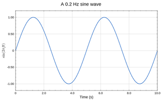</a><br><sub>Sine curve</sub></td>
<td align="center" width="20%"><a href="crates/renderer/gallery/lines.md#error-bars">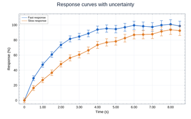</a><br><sub>Error bars</sub></td>
<td align="center" width="20%"><a href="crates/renderer/gallery/lines.md#forecast-bands">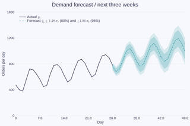</a><br><sub>Forecast bands</sub></td>
<td align="center" width="20%"><a href="crates/renderer/gallery/lines.md#step-schedule">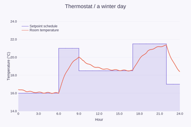</a><br><sub>Step schedule</sub></td>
<td align="center" width="20%"><a href="crates/renderer/gallery/lines.md#stem-plot">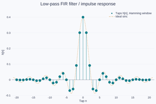</a><br><sub>Stem plot</sub></td>
</tr>
<tr>
<td align="center" width="20%"><a href="crates/renderer/gallery/lines.md#lollipop-chart">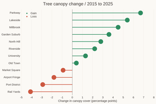</a><br><sub>Lollipop chart</sub></td>
<td align="center" width="20%"><a href="crates/renderer/gallery/lines.md#travelling-waves">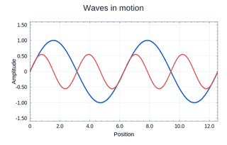</a><br><sub>Travelling waves</sub></td>
<td align="center" width="20%"><a href="crates/renderer/gallery/lines.md#animated-orbit">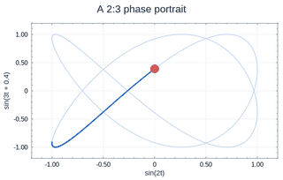</a><br><sub>Animated orbit</sub></td>
</tr>
</table>

### [Bars and distributions](crates/renderer/gallery/distributions.md)

<table>
<tr>
<td align="center" width="20%"><a href="crates/renderer/gallery/distributions.md#grouped-bars">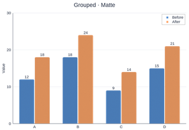</a><br><sub>Grouped bars</sub></td>
<td align="center" width="20%"><a href="crates/renderer/gallery/distributions.md#histogram">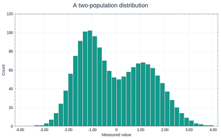</a><br><sub>Histogram</sub></td>
<td align="center" width="20%"><a href="crates/renderer/gallery/distributions.md#horizontal-histogram">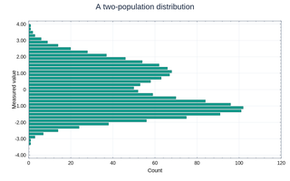</a><br><sub>Horizontal histogram</sub></td>
<td align="center" width="20%"><a href="crates/renderer/gallery/distributions.md#box-plot">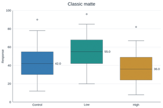</a><br><sub>Box plot</sub></td>
<td align="center" width="20%"><a href="crates/renderer/gallery/distributions.md#split-violins">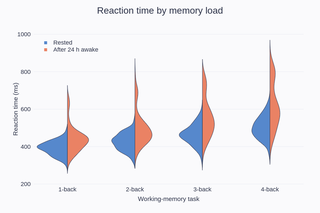</a><br><sub>Split violins</sub></td>
</tr>
<tr>
<td align="center" width="20%"><a href="crates/renderer/gallery/distributions.md#raincloud-plot">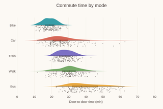</a><br><sub>Raincloud plot</sub></td>
</tr>
</table>

### [Ranges and timelines](crates/renderer/gallery/ranges.md)

<table>
<tr>
<td align="center" width="20%"><a href="crates/renderer/gallery/ranges.md#waterfall">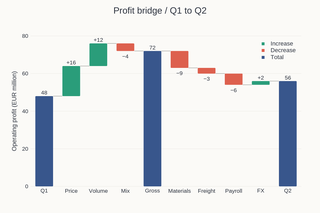</a><br><sub>Waterfall</sub></td>
<td align="center" width="20%"><a href="crates/renderer/gallery/ranges.md#candlesticks">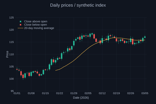</a><br><sub>Candlesticks</sub></td>
<td align="center" width="20%"><a href="crates/renderer/gallery/ranges.md#gantt-chart">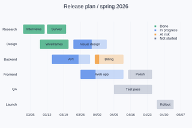</a><br><sub>Gantt chart</sub></td>
</tr>
</table>

### [Fields and maps](crates/renderer/gallery/fields.md)

<table>
<tr>
<td align="center" width="20%"><a href="crates/renderer/gallery/fields.md#heatmap-with-contours">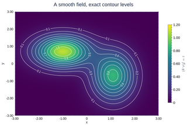</a><br><sub>Heatmap with contours</sub></td>
<td align="center" width="20%"><a href="crates/renderer/gallery/fields.md#hexbin">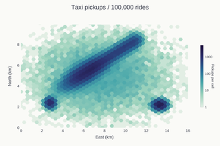</a><br><sub>Hexbin</sub></td>
<td align="center" width="20%"><a href="crates/renderer/gallery/fields.md#colour-image">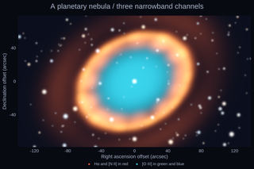</a><br><sub>Colour image</sub></td>
<td align="center" width="20%"><a href="crates/renderer/gallery/fields.md#triangle-mesh">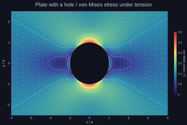</a><br><sub>Triangle mesh</sub></td>
<td align="center" width="20%"><a href="crates/renderer/gallery/fields.md#wind-field">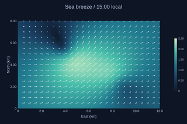</a><br><sub>Wind field</sub></td>
</tr>
<tr>
<td align="center" width="20%"><a href="crates/renderer/gallery/fields.md#surface-currents">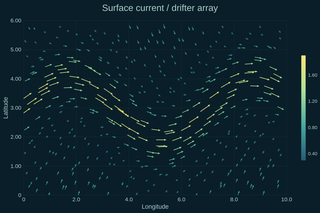</a><br><sub>Surface currents</sub></td>
<td align="center" width="20%"><a href="crates/renderer/gallery/fields.md#colour-mapped-points">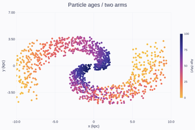</a><br><sub>Colour-mapped points</sub></td>
<td align="center" width="20%"><a href="crates/renderer/gallery/fields.md#bubble-chart">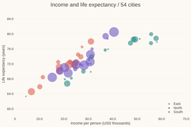</a><br><sub>Bubble chart</sub></td>
</tr>
</table>

### [3D](crates/renderer/gallery/3d.md)

<table>
<tr>
<td align="center" width="20%"><a href="crates/renderer/gallery/3d.md#3d-surface">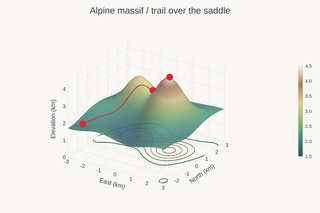</a><br><sub>3D surface</sub></td>
<td align="center" width="20%"><a href="crates/renderer/gallery/3d.md#3d-triangle-surface">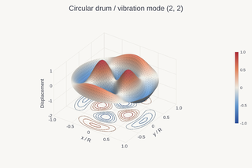</a><br><sub>3D triangle surface</sub></td>
<td align="center" width="20%"><a href="crates/renderer/gallery/3d.md#3d-vector-field">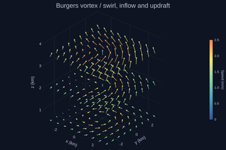</a><br><sub>3D vector field</sub></td>
</tr>
</table>

### [Polar and radial](crates/renderer/gallery/polar.md)

<table>
<tr>
<td align="center" width="20%"><a href="crates/renderer/gallery/polar.md#polar-plot">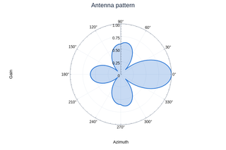</a><br><sub>Polar plot</sub></td>
<td align="center" width="20%"><a href="crates/renderer/gallery/polar.md#compass-rose">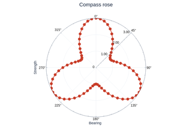</a><br><sub>Compass rose</sub></td>
<td align="center" width="20%"><a href="crates/renderer/gallery/polar.md#polar-heatmap">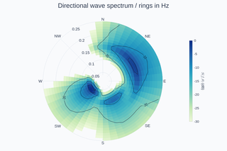</a><br><sub>Polar heatmap</sub></td>
<td align="center" width="20%"><a href="crates/renderer/gallery/polar.md#wind-rose">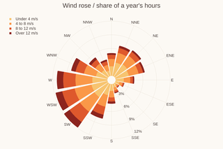</a><br><sub>Wind rose</sub></td>
<td align="center" width="20%"><a href="crates/renderer/gallery/polar.md#radar-chart">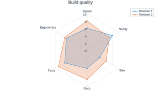</a><br><sub>Radar chart</sub></td>
</tr>
<tr>
<td align="center" width="20%"><a href="crates/renderer/gallery/polar.md#radar-with-value-labels">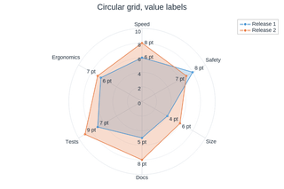</a><br><sub>Radar with value labels</sub></td>
<td align="center" width="20%"><a href="crates/renderer/gallery/polar.md#donut">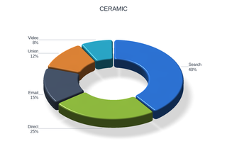</a><br><sub>Donut</sub></td>
<td align="center" width="20%"><a href="crates/renderer/gallery/polar.md#sunburst">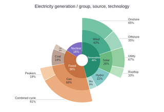</a><br><sub>Sunburst</sub></td>
</tr>
</table>

### [Science diagrams](crates/renderer/gallery/science.md)

<table>
<tr>
<td align="center" width="20%"><a href="crates/renderer/gallery/science.md#energy-levels">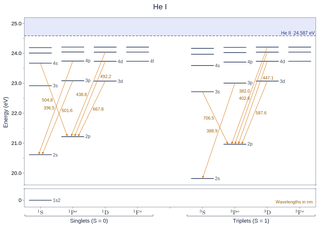</a><br><sub>Energy levels</sub></td>
<td align="center" width="20%"><a href="crates/renderer/gallery/science.md#feynman-diagrams">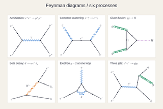</a><br><sub>Feynman diagrams</sub></td>
<td align="center" width="20%"><a href="crates/renderer/gallery/science.md#ternary-plot">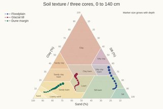</a><br><sub>Ternary plot</sub></td>
<td align="center" width="20%"><a href="crates/renderer/gallery/science.md#probability-paper">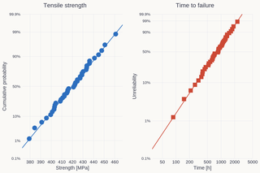</a><br><sub>Probability paper</sub></td>
<td align="center" width="20%"><a href="crates/renderer/gallery/science.md#parallel-coordinates">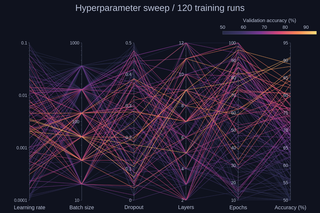</a><br><sub>Parallel coordinates</sub></td>
</tr>
</table>

### [Layouts and annotations](crates/renderer/gallery/layouts.md)

<table>
<tr>
<td align="center" width="20%"><a href="crates/renderer/gallery/layouts.md#twin-axes">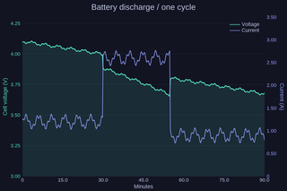</a><br><sub>Twin axes</sub></td>
<td align="center" width="20%"><a href="crates/renderer/gallery/layouts.md#small-multiples">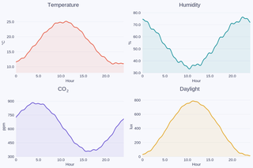</a><br><sub>Small multiples</sub></td>
<td align="center" width="20%"><a href="crates/renderer/gallery/layouts.md#broken-axis">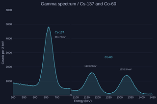</a><br><sub>Broken axis</sub></td>
<td align="center" width="20%"><a href="crates/renderer/gallery/layouts.md#shape-annotations">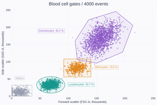</a><br><sub>Shape annotations</sub></td>
</tr>
</table>

### [Styles and visual concepts](crates/renderer/gallery/styles.md)

<table>
<tr>
<td align="center" width="20%"><a href="crates/renderer/gallery/styles.md#precise-style">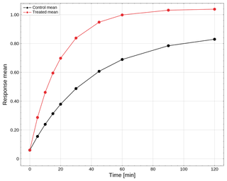</a><br><sub>Precise style</sub></td>
<td align="center" width="20%"><a href="crates/renderer/gallery/styles.md#sketch-style">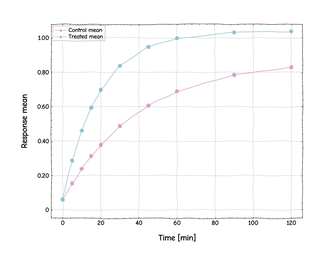</a><br><sub>Sketch style</sub></td>
<td align="center" width="20%"><a href="crates/renderer/gallery/styles.md#milkyway-style">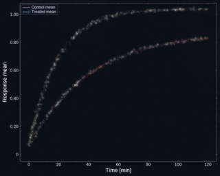</a><br><sub>Milkyway style</sub></td>
<td align="center" width="20%"><a href="crates/renderer/gallery/styles.md#constellation-style">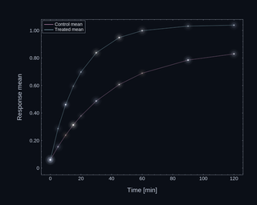</a><br><sub>Constellation style</sub></td>
<td align="center" width="20%"><a href="crates/renderer/gallery/styles.md#dark-dashboard">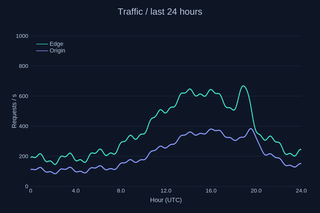</a><br><sub>Dark dashboard</sub></td>
</tr>
<tr>
<td align="center" width="20%"><a href="crates/renderer/gallery/styles.md#revenue-stacks"></a><br><sub>Revenue stacks</sub></td>
<td align="center" width="20%"><a href="crates/renderer/gallery/styles.md#editorial-sketch"></a><br><sub>Editorial sketch</sub></td>
<td align="center" width="20%"><a href="crates/renderer/gallery/styles.md#toon-pie"></a><br><sub>Toon pie</sub></td>
<td align="center" width="20%"><a href="crates/renderer/gallery/styles.md#pearl-donut"></a><br><sub>Pearl donut</sub></td>
<td align="center" width="20%"><a href="crates/renderer/gallery/styles.md#terrain"></a><br><sub>Terrain</sub></td>
</tr>
</table>
[Six editable visual recipes](crates/renderer/GALLERY.md#visual-concepts) show how
palettes, axes, materials and labels restyle charts built with the same APIs.
The [example index](crates/renderer/examples/README.md#gallery-images) lists
every image with its function, and [the gallery notes](crates/renderer/GALLERY.md)
give the reproduction commands.

## Chart types

| Chart | Input | Guide |
|---|---|---|
| Lines and scatter | `f64` columns through `ColumnSource` | [Usage](crates/renderer/USAGE.md) · [Series schema](crates/renderer/CONFIG.md#data_config--declarative-series-schema-the-active-api) |
| Area fills and step lines | A line's `fill` (to a baseline or another series) and `interpolation` | [Area fill and step lines](crates/renderer/CONFIG.md#area-fill-and-step-lines) · [area_step.rs](crates/renderer/examples/area_step.rs) |
| Monotonic-x lines (large, evenly spaced signals) | Samples at `start + i × interval`, lent on every call through a `MonotonicSource` and not retained after the call; each pixel column draws its first, lowest, highest and last sample (`MonotonicLine` series in a chart from `Renderer::register_monotonic_chart`; `set_monotonic`, `append_monotonic`) | [Monotonic-x lines](crates/renderer/USAGE.md#monotonic-x-lines) · [MONOTONIC.md](crates/model/MONOTONIC.md) |
| Error bars | X, Y and error columns | [error_bars.rs](crates/renderer/examples/error_bars.rs) |
| Stems and lollipops | An `XySeries` with markers and a `stem`: one stroke per point from a baseline, along y for an impulse response, along x for a ranked lollipop | [Stems](crates/renderer/CONFIG.md#stems) |
| Histograms | Bin edges and counts | [Histograms](crates/renderer/HISTOGRAM.md) |
| Heatmaps and contours | X and Y coordinate columns and one z column per grid row or column (`MatrixRef`) | [heatmap_contours.rs](crates/renderer/examples/heatmap_contours.rs) |
| Hexbins | Host-binned counts on a `Hexagonal` grid of flat-topped hexagons (`MatrixRef.grid_layout`) | [Hexagonal grids](crates/renderer/CONFIG.md#hexagonal-grids-hexbins) |
| Colour images (imshow) | Three channel grids on one lattice, mapped from a `range` (`RgbImage`) | [Colour images](crates/renderer/CONFIG.md#colour-images-imshow) |
| Parallel coordinates | One column per axis (`Parallel`) on a chart with `Config.parallel`, each axis its own range | [Parallel coordinates](crates/renderer/CONFIG.md#parallel-coordinates) |
| Vector fields (quiver) | Anchors and (u, v) columns, or two matrices on a grid | [Vector fields](crates/renderer/CONFIG.md#vector-fields) · [vector_field.rs](crates/renderer/examples/vector_field.rs) |
| Colour and size maps (bubbles) | A value column per point, mapped by `PointColorMap` through the colorbar (`Config.colorbar`) or by `PointSizeMap` through its size domain | [Point colour and size maps](crates/renderer/CONFIG.md#point-colour-and-size-maps) · [value_maps.rs](crates/renderer/examples/value_maps.rs) |
| Probability axes | `AxisScale::Probability` (normal, Weibull or logistic paper) on a value axis; the host computes the plotting positions and any fit | [Axis options](crates/renderer/CONFIG.md#axisoptions-top_x--bottom_x--left_y--right_y) · [probability_paper.rs](crates/renderer/examples/probability_paper.rs) |
| Broken axes | `AxisBreaks` on a value axis: ranges cut out, each cut marked as a gap, the pieces sized by span, equally or by weight | [Axis breaks](crates/renderer/CONFIG.md#axisbreaks) |
| Insets | A subplot drawn over its parent with an `InsetMarker`: the magnified window and connectors on the parent, dragged and resized like any subplot | [Subplots and insets](crates/renderer/CONFIG.md#subplot-configsubplots) |
| Overlay axes, subplots, annotations | Overlay layers with their own Y axis on the right and, when unlinked, their own X axis on the top, a grid of panels, reference lines, spans, text, arrows and shapes (rectangles, ellipses, polygons) | [Overlays](crates/renderer/INTERACTION.md#overlay-layers) · [Subplots](crates/renderer/INTERACTION.md#subplots) · [Annotations](crates/renderer/INTERACTION.md#annotation-layer) |
| Polar plots | (angle, radius) columns and `Config.polar`; heatmaps and contours draw as annular cells | [Polar](crates/renderer/POLAR.md) · [Heatmaps](crates/renderer/POLAR.md#heatmaps-and-contours) |
| Ternary plots | Three component columns per `Ternary` series and `Config.ternary`; region fills of the polygons a series outlines | [Ternary](crates/renderer/TERNARY.md) |
| Triangle meshes (tripcolor, tricontour, trisurf) | Vertex coordinate and value columns and a triangle index column (`TriMesh`, `Renderer::upsert_triangles`): the host's triangulation, a colour field and contour lines over it; with `Config.view_3d` and a `z_column` a surface in the box | [Triangle meshes](crates/renderer/TRIMESH.md) |
| 3D surfaces | A heatmap's grid or a triangle mesh drawn as a surface in a box with `Config.view_3d`, with points and trajectories from a `z_column`, and vector fields as arrows along `(u, v, w)` | [Surface](crates/renderer/SURFACE.md) |
| Categorical bars | A categorical axis, category positions and one value column per bar series (`CategoryBars`); legacy `CategoricalChart` documents open through `Config::from_categorical`; on a polar chart the bars are a rose | [Bars](crates/renderer/CATEGORICAL.md) · [Roses](crates/renderer/POLAR.md#roses-polar-bars) |
| Box plots, violins, rainclouds | A categorical axis, category positions, one record of supplied box statistics and one ragged outlier column per box series (`BoxPlot`), with the host's density curves as ragged columns for violins and two point columns for raw points; legacy `BoxPlotChart` documents open through `Config::from_boxplot` | [Boxes](crates/renderer/BOXPLOT.md) |
| Waterfalls, candlesticks, Gantt charts | A position column and start and end columns per range bar series (`RangeBars`), with optional low/high, total-flag or state and progress columns | [Range bars](crates/renderer/RANGEBARS.md) |
| Radar charts | A categorical angle axis on a polar chart, category positions and one value column per radar series (`Radar`); legacy `RadarChart` documents open through `Config::from_radar` | [Radar](crates/renderer/RADAR.md) |
| Energy-level (Grotrian) diagrams | `EnergyLevels` records in the document: levels in term columns of a categorical axis and the transitions the host lists, parsed by the host from NIST Atomic Spectra Database exports; labels are placed automatically, and an inset can magnify the fine structure | [Energy levels](crates/renderer/CONFIG.md#energy-levels-datarendertypeenergylevels) · [nist_grotrian.rs](crates/renderer/examples/nist_grotrian.rs) |
| Feynman diagrams | `Feynman` records in the document: vertices and the propagators joining them, each stroke naming its particle (fermion, photon, gluon, scalar and more); a vertex without a position is laid out automatically | [Feynman diagrams](crates/renderer/FEYNMAN.md) |
| Pies and donuts | `RadialChart` values | [Radial (in Korean)](crates/renderer/RADIAL.md) |
| Sunbursts | `RadialChart` slices with `children`: nested rings over their parents' spans | [Radial (in Korean)](crates/renderer/RADIAL.md#선버스트중첩-고리) |

Every row above pies and donuts is drawn by `Renderer`. Their per-point data
enters through `ColumnSource`, except that monotonic-x lines lend their samples
through a `MonotonicSource`, and energy-level and Feynman diagrams are records
in the chart's configuration. Overlay axes and subplots work with these charts,
except that a polar chart takes no overlay axes. Streamed, non-resident
sources draw lines, scatter, error bars and heatmaps in a single-panel
document. Contours, fills and step lines, vector fields, colour and size maps,
polar plots, and documents with overlays or subplots reject streamed sources
with an explicit error, and so do histograms, categorical bars, box plots,
range bars and radar series. Pies and donuts keep their values in their own model
(`RadialChart`), with no `ColumnSource`, and are drawn by `RadialRenderer`. The
annotation layer works with both renderers.

## Quick start

Use **Rust 1.99 or later** and a working GPU driver. The repository pins Rust 1.99.0.
Add these dependencies to your application's `Cargo.toml`:

```toml
[dependencies]
renderer = { package = "figgy-renderer", version = "0.18.1" }
```

The `version` line installs [figgy-renderer](https://crates.io/crates/figgy-renderer)
0.18.1, with figgy-model 0.12.1, from crates.io. With a local checkout, use
`path = "../figgy/crates/renderer"` (relative to your application) instead of
`version`. Code written for 0.17.0 needs the changes in the
[migration notes](CHANGELOG.md#migrating-from-0170).

Copy this into `src/main.rs`, then run `cargo run`. It writes `line.png` without
opening a window. `renderer` is the Rust import name of the `figgy-renderer` package.

```rust
use renderer::{Chart, Color, ExportOptions, ExportSource, Renderer, SeriesConfig};

fn main() -> Result<(), Box<dyn std::error::Error>> {
    let mut renderer = Renderer::headless_blocking()?;
    let x: Vec<f64> = (0..=100).map(|i| f64::from(i) / 10.0).collect();
    let f = 0.2;
    let y: Vec<f64> = x
        .iter()
        .map(|t| (std::f64::consts::TAU * f * t).sin())
        .collect();
    renderer.add_column("x", &x)?;
    renderer.add_column("y", &y)?;

    let series = [SeriesConfig::line("sine", "x", "y")
        .color(Color::from_rgb8(34, 104, 198))
        .width(2.5)];
    let mut chart = Chart::sized(960, 600)
        .with_title("A 0.2 Hz sine wave")
        .with_x_title("Time (s)")
        // A `$…$` span in a title is TeX.
        .with_y_title(r"$\sin(2\pi f t)$");
    chart.set_x_range(0.0, 10.0);
    chart.set_y_range(-1.2, 1.2);
    chart.fit_layout();

    let output = std::env::args_os()
        .nth(1)
        .unwrap_or_else(|| "line.png".into());
    let options = ExportOptions::panel(1.0).with_clear(Color::WHITE);
    renderer.save_blocking(ExportSource::chart(&chart, &series), options, &output)?;
    println!("{}", std::path::Path::new(&output).display());
    Ok(())
}
```

`Renderer::headless_blocking` makes the GPU device itself, and `save_blocking`
writes the format the file name's extension names (`.png`, `.svg` or `.pdf`).
A host that also wants the bytes or pixels calls `export_png_blocking` or
`export_rgba_blocking` instead. A host that embeds figgy in its own window adds a
`wgpu = "30"` dependency and shares its device through `RendererDevice`.
For your own data, replace the `x`/`y` vectors or implement
[`ColumnSource`](crates/renderer/USAGE.md#columnsource--the-data-adapter-trait).

### Polar plots and radar charts in a few lines

A polar plot is a Cartesian chart with `Config.polar` set. `x_column` holds the
angle (in degrees by default) and `y_column` the radius; the angle axis becomes
the outer ring and the radius axis a labelled ray. `set_y_range` sets the radius
axis. `set_x_range` only chooses which angle ticks, spokes and labels are drawn:
one turn is always 360° (or 2π) from `zero_angle_degrees`, so a range such as
0..180 does not stretch onto the full circle; the `sector` field of
`PolarOptions` shows part of it. To turn the quick start into a polar plot,
upload angle and radius columns in place of the sine and set up the chart like
this:

```rust,ignore
use renderer::{format::LabelFormat, polar::PolarOptions};

chart.config_mut().set_polar(Some(PolarOptions::default())); // 0° right, counter-clockwise
chart.set_x_range(0.0, 360.0); // which angle ticks and spokes are drawn
chart.set_y_range(0.0, 1.0); // radius axis
// The range helpers choose tick spacing and label format, so set these after them.
chart.config_mut().bottom_x.major_spacing = 30.0; // spokes every 30°
chart.config_mut().bottom_x.label_style.format = LabelFormat::Degrees; // "30°"
```

A radar chart is a polar chart whose angle axis is categorical, drawn with
`DataRenderType::Radar` series. A `RadarChart` document opens through
`Config::from_radar`, which returns the chart, its series and the columns to
upload, borrowed from the document:

```rust,ignore
use renderer::radar::{RadarChart, RadarSeries};
use renderer::{Category, Chart, Color, config::Config, encode_png};

let mut chart = RadarChart::default();
chart.categories = ["Speed", "Safety", "Size", "Docs", "Tests"]
    .iter()
    .map(|c| Category::new(c.to_lowercase(), *c))
    .collect();
chart.series = vec![
    RadarSeries::new("v1", "Release 1", vec![6.0, 8.0, 4.0, 5.0, 7.0], Color::from_rgb8(60, 110, 200)),
    RadarSeries::new("v2", "Release 2", vec![8.0, 7.0, 6.0, 8.0, 9.0], Color::from_rgb8(220, 90, 70)),
];
chart.value_range = Some([0.0, 10.0]);
chart.validate()?;
// `renderer` is the quick start's `Renderer`.
let (mut config, series, uploads) = Config::from_radar(&chart);
config.chart_area = renderer::layout::ChartArea(renderer::layout::Rect { x: 0, y: 0, width: 720, height: 520 });
for upload in &uploads {
    renderer.add_column(upload.column.clone(), &upload.values)?;
}
let chart = Chart::new(config);
let image = renderer.export_rgba_blocking(
    renderer::ExportSource::chart(&chart, &series),
    renderer::ExportOptions::panel(1.0),
)?;
std::fs::write("radar.png", encode_png(&image)?)?;
```

The complete programs are [polar_plot.rs](crates/renderer/examples/polar_plot.rs)
and [radar_gallery.rs](crates/renderer/examples/radar_gallery.rs); the guides are
[Polar](crates/renderer/POLAR.md) and [Radar](crates/renderer/RADAR.md).

## Run the examples

From a checkout of this repository:

```bash
cargo run --locked -p figgy-renderer --example line
cargo run --locked -p figgy-renderer --example gallery_concepts -- target/concepts
cargo run --locked -p figgy-renderer --example vector_field -- target/vector-field
cargo run --locked -p figgy-renderer --example value_maps -- target/value-maps
cargo run --locked -p figgy-renderer --example area_step -- target/area-step
cargo run --locked -p figgy-renderer --example overlay_axes -- target/overlay-axes
cargo run --locked -p figgy-renderer --example subplots -- target/subplots
cargo run --locked -p figgy-renderer --example error_bars -- target/error-bars
cargo run --locked -p figgy-renderer --example histogram -- target/histogram
cargo run --locked -p figgy-renderer --example heatmap_contours -- target/heatmap-contours
cargo run --locked -p figgy-renderer --example radial_gallery -- target/radial-gallery
cargo run --locked -p figgy-renderer --example categorical_gallery -- target/categorical-gallery
cargo run --locked -p figgy-renderer --example boxplot_gallery -- target/boxplot-gallery
cargo run --locked -p figgy-renderer --example radar_gallery -- target/radar-gallery
cargo run --locked -p figgy-renderer --example polar_plot -- target/polar-plot
```

See the [example index](crates/renderer/examples/README.md) for the function and
command behind every gallery image, the outputs of every headless example,
animations and interactive examples.

## Embed and edit

| Goal | Example or guide |
|---|---|
| Draw in a native window | [winit_simple.rs](crates/renderer/examples/winit_simple.rs) |
| Embed in egui | [egui_embed.rs](crates/renderer/examples/egui_embed.rs), run with `--features egui_demo` |
| Edit pies or donuts | [Native editors](crates/renderer/examples/README.md#interactive-examples) |
| Connect picking, dragging and plot-area resizing | [Interaction guide](crates/renderer/INTERACTION.md) |
| Fit margins, title offsets and label formats so labels and titles do not overlap | `layout::auto_layout` in the [convenience helpers](crates/renderer/API.md#direct-ssot-edits-and-convenience-helpers); `autoLayout(configJson)` in the browser |
| Render data that does not fit in GPU memory | [Streaming and residency](crates/renderer/ARCHITECTURE.md#exact-streaming-and-residency) |

The Rust renderer can share a device with a **wgpu 30** host. No GUI framework is
required by default.

## WebAssembly and the browser

The Rust renderer also compiles to `wasm32-unknown-unknown` and renders through
WebGPU. [`crates/web`](crates/web/README.md) is figgy's **browser product**: the
wasm-bindgen wrapper and the `<figgy-chart>` custom element, which connect a
canvas, events and async calls. It is developed alongside the renderer and has
wrapper methods for every renderer feature. Its JavaScript API is its own,
separate from the Rust library's API. The `FiggyChart` export and the
`<figgy-chart>` element cover Cartesian charts (categorical bars and box plots
included) and polar charts (radar charts included, through
`set_radar_document`). `FiggyBoundedChart`, the radial chart host, covers pies
and donuts; your page handles their canvas events. The wrapper is the Cargo package `figgy`, built from
this repository (`publish = false`); the `figgy` crate on crates.io and the
`figgy` package on npm are unrelated projects.

[Build and run figgy in the browser](crates/web/README.md).
[figgyplot.com Studio](https://figgyplot.com/) is a separate web application, not
part of the `figgy-renderer` crate or the browser product.

## Documentation

| Topic | Guide |
|---|---|
| Native setup, data adapters, embedding and export | [Usage](crates/renderer/USAGE.md) |
| Axes, labels, legends, series and color maps | [Configuration reference](crates/renderer/CONFIG.md) |
| Pies/donuts · categorical bars · box plots · range bars · radar · polar · histograms | [Radial (in Korean)](crates/renderer/RADIAL.md) · [Bars](crates/renderer/CATEGORICAL.md) · [Boxes](crates/renderer/BOXPLOT.md) · [Range bars](crates/renderer/RANGEBARS.md) · [Radar](crates/renderer/RADAR.md) · [Polar](crates/renderer/POLAR.md) · [Histograms](crates/renderer/HISTOGRAM.md) 
| Ternary plots · 3D surfaces · triangle meshes · Feynman diagrams · monotonic-x lines | [Ternary](crates/renderer/TERNARY.md) · [Surface](crates/renderer/SURFACE.md) · [Triangle meshes](crates/renderer/TRIMESH.md) · [Feynman](crates/renderer/FEYNMAN.md) · [Monotonic-x lines](crates/model/MONOTONIC.md) |
| Ownership, prepared frames and API compatibility | [API contracts](crates/renderer/API.md) |
| Memory flow, caching, streaming and shader details | [Architecture](crates/renderer/ARCHITECTURE.md) |
| Source versions and migration notes | [Changelog](CHANGELOG.md) |
| Platform checks and known limits | [CI results](ci/STATUS.md) |

Linux/Vulkan and Windows/DX12 are covered by native rendering and pixel tests.
**macOS/Metal support remains experimental.** CI uses software or virtual GPU
adapters; its results do not establish coverage of every physical GPU driver.

## Contributing and security

See [CONTRIBUTING.md](CONTRIBUTING.md) for bug reports, development checks and pull
requests. Report suspected vulnerabilities privately using [SECURITY.md](SECURITY.md).

## License

Code: [MIT](LICENSE-MIT) or [Apache-2.0](LICENSE-APACHE).
Bundled fonts retain their OFL and GUST notices: [Liberation Sans](crates/renderer/fonts/LICENSE-LiberationSans.txt)
and [Comic Neue](crates/renderer/fonts/LICENSE-ComicNeue.txt) (SIL OFL 1.1), and
[New Computer Modern Math](crates/renderer/fonts/LICENSE-NewCMMath.txt) (GUST Font License),
the face used for formulas in rich text.
