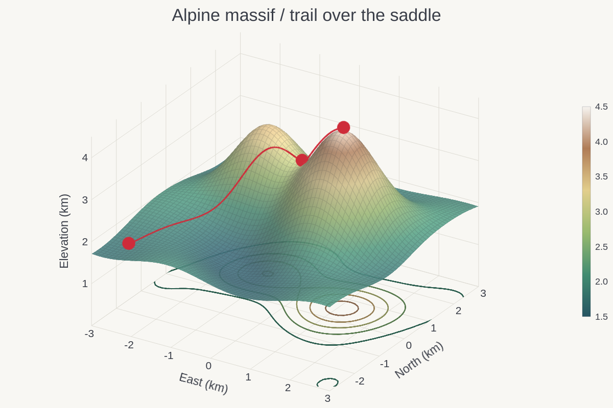
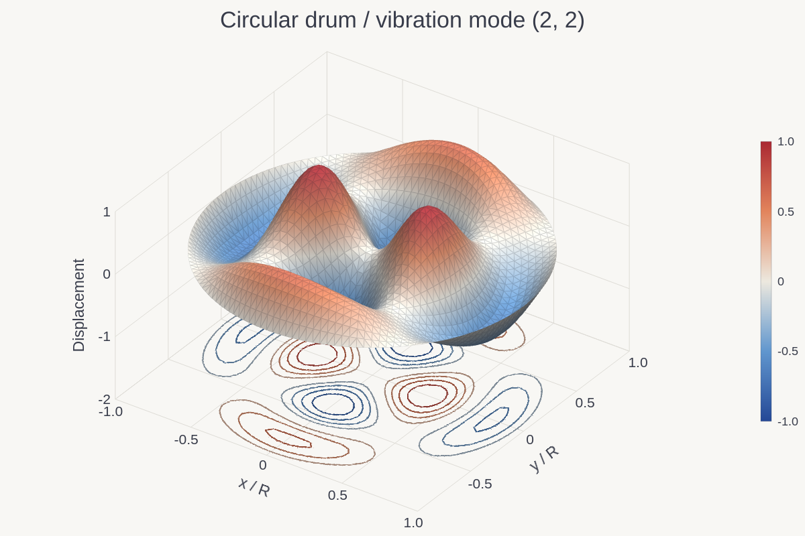
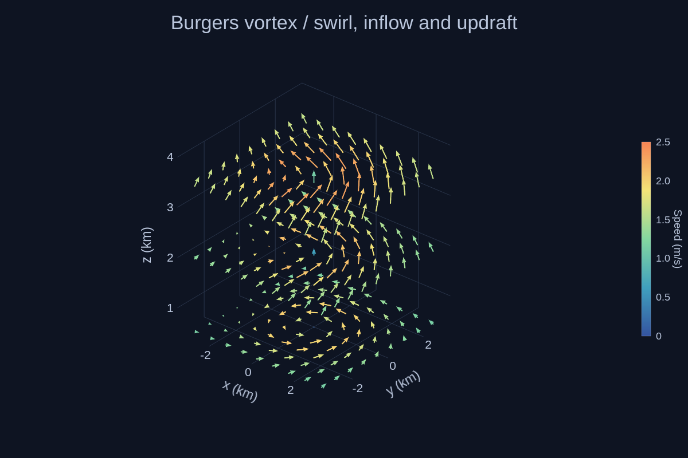

# 3D

[← Gallery](../../../README.md#gallery) · [Lines, areas and stems](lines.md) · [Bars and distributions](distributions.md) · [Ranges and timelines](ranges.md) · [Fields and maps](fields.md) · **3D** · [Polar and radial](polar.md) · [Science diagrams](science.md) · [Layouts and annotations](layouts.md) · [Styles and visual concepts](styles.md)

Click an image to open the example code that draws it. All data is synthetic;
the images are native renderer output.

## 3D surface

Two summits and a saddle as a lit, wireframed 3D surface on a 61 × 61 grid (`view_3d`), floor contours in the ramp's colours, and a trail with waypoints as 3D line and marker series with a `z_column`.

**Code:** [surface_3d.rs](../examples/surface_3d.rs), `terrain`

**Run:** `cargo run --locked -p figgy-renderer --example surface_3d -- target/surface-3d`

## 3D triangle surface

The (2, 2) mode of a circular drum on a disc mesh, a lit and wireframed 3D triangle surface on a diverging ramp, with floor contours.

**Code:** [trimesh.rs](../examples/trimesh.rs), `drum`

**Run:** `cargo run --locked -p figgy-renderer --example trimesh -- target/trimesh`

## 3D vector field

A Burgers vortex sampled on a 9 × 9 × 3 lattice: one arrow per sample along (u, v, w), coloured by a host speed column through the colourbar.

**Code:** [surface_3d.rs](../examples/surface_3d.rs), `vortex`

**Run:** `cargo run --locked -p figgy-renderer --example surface_3d -- target/surface-3d`
