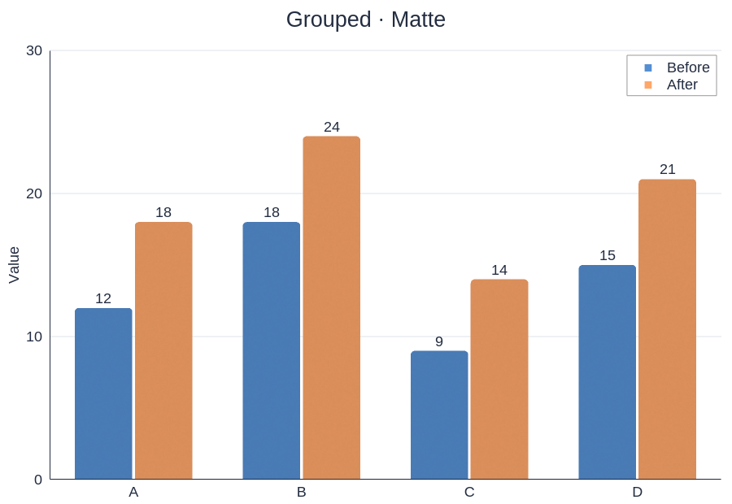
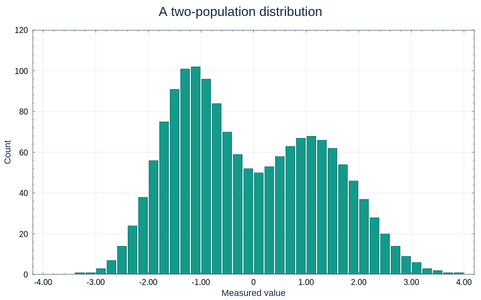
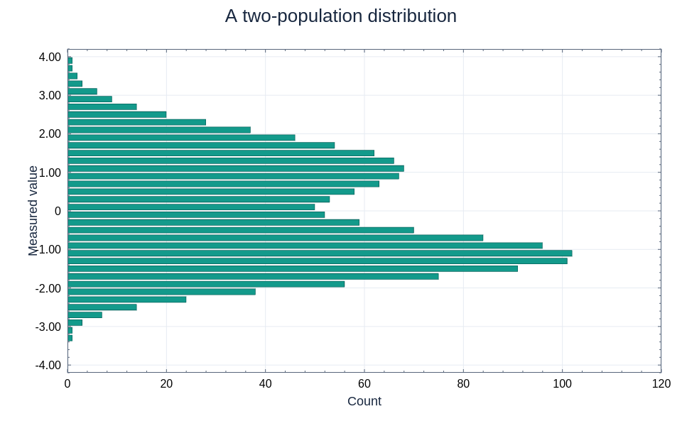
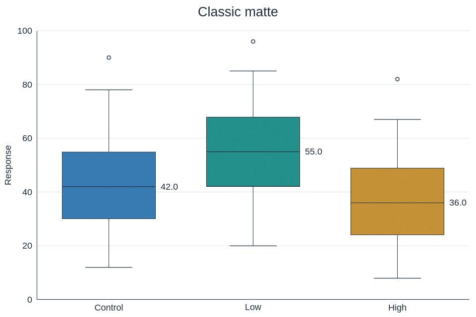
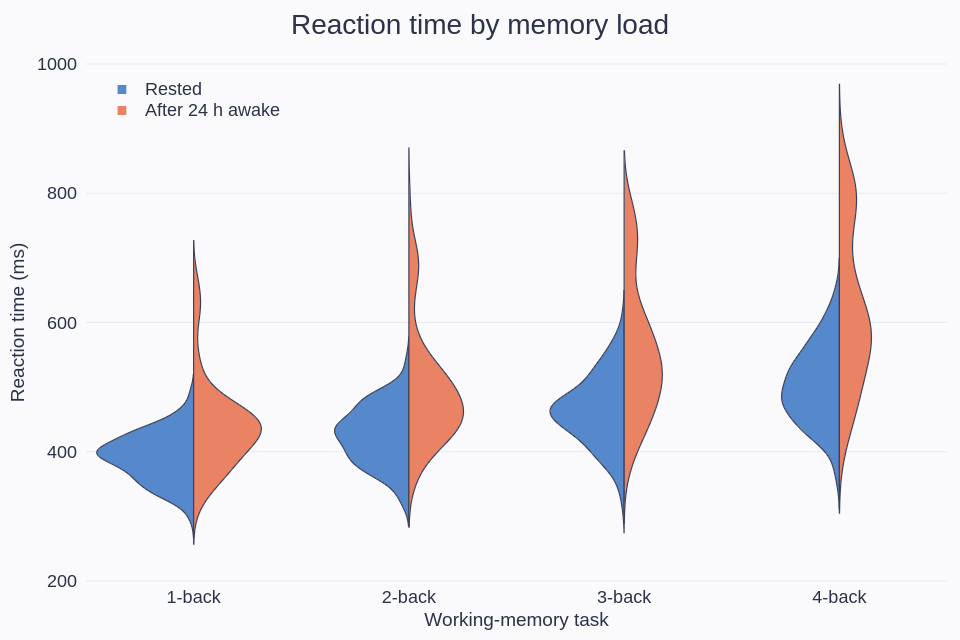
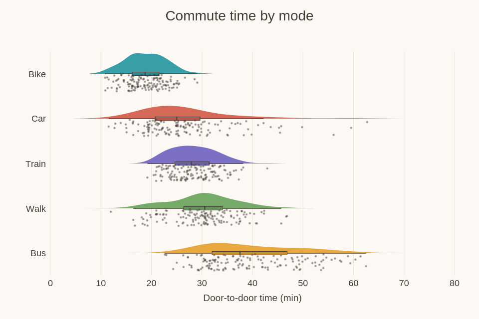

# Bars and distributions

[← Gallery](../../../README.md#gallery) · [Lines, areas and stems](lines.md) · **Bars and distributions** · [Ranges and timelines](ranges.md) · [Fields and maps](fields.md) · [3D](3d.md) · [Polar and radial](polar.md) · [Science diagrams](science.md) · [Layouts and annotations](layouts.md) · [Styles and visual concepts](styles.md)

Click an image to open the example code that draws it. All data is synthetic;
the images are native renderer output.
Each entry names the built-in theme its example applies
([Themes](../USAGE.md#themes)); some examples edit a copy first, such as the
palette order or a fill opacity.

## Grouped bars

Two series across four categories, a value label past every bar.

**Code:** [categorical_gallery.rs](../examples/categorical_gallery.rs), case `grouped-matte`

**Theme:** `category-bars` theme `document`

**Run:** `cargo run --locked -p figgy-renderer --example categorical_gallery -- target/categorical-gallery`

## Histogram

40 supplied bins; the renderer draws the counts it is given.

**Code:** [histogram.rs](../examples/histogram.rs), `render`

**Theme:** `histogram` theme `gallery`

**Run:** `cargo run --locked -p figgy-renderer --example histogram -- target/histogram`

## Horizontal histogram

The same bins with horizontal bars.

**Code:** [histogram.rs](../examples/histogram.rs), `render`

**Theme:** `histogram` theme `gallery`

**Run:** `cargo run --locked -p figgy-renderer --example histogram -- target/histogram`

## Box plot

Supplied five-number summaries and outliers, the median above every box.

**Code:** [boxplot_gallery.rs](../examples/boxplot_gallery.rs), case `01-classic-matte`

**Theme:** `distribution` theme `document`

**Run:** `cargo run --locked -p figgy-renderer --example boxplot_gallery -- target/boxplot-gallery`

## Split violins

Split violins: reaction times under four memory loads, rested on the left half and after 24 h awake on the right; each half is the host's density curve as a ragged column.

**Code:** [boxplot_gallery.rs](../examples/boxplot_gallery.rs), `violins`

**Theme:** `distribution` theme `cool-slate`

**Run:** `cargo run --locked -p figgy-renderer --example boxplot_gallery -- target/boxplot-gallery`

## Raincloud plot

Horizontal rainclouds of commute time by mode: the host's half violin above a quartile box, the raw samples jittered below.

**Code:** [boxplot_gallery.rs](../examples/boxplot_gallery.rs), `raincloud`

**Theme:** `distribution` theme `warm-paper`

**Run:** `cargo run --locked -p figgy-renderer --example boxplot_gallery -- target/boxplot-gallery`
