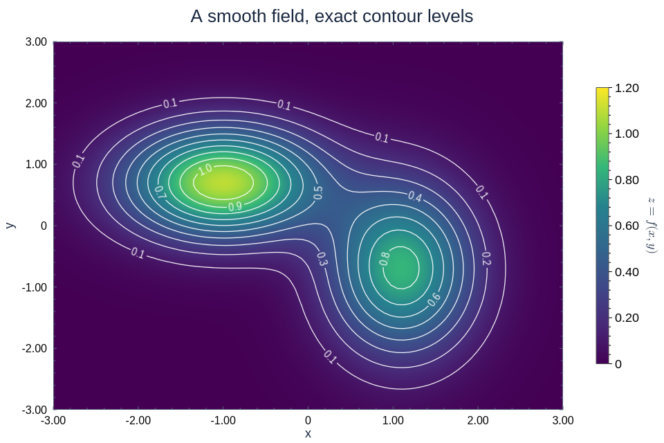
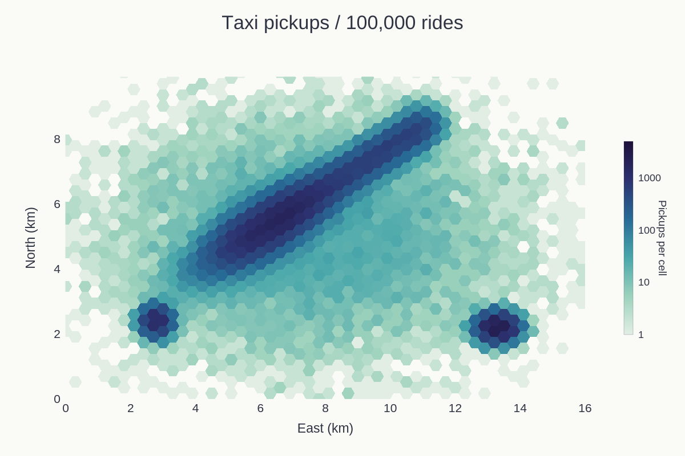
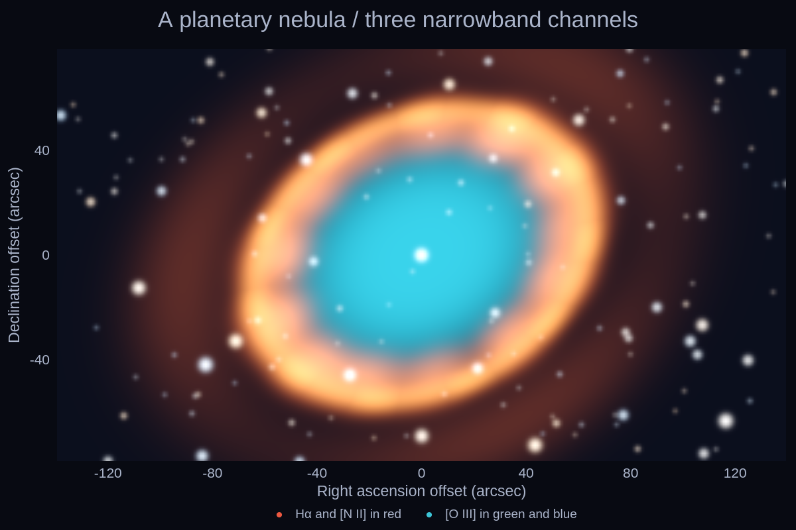
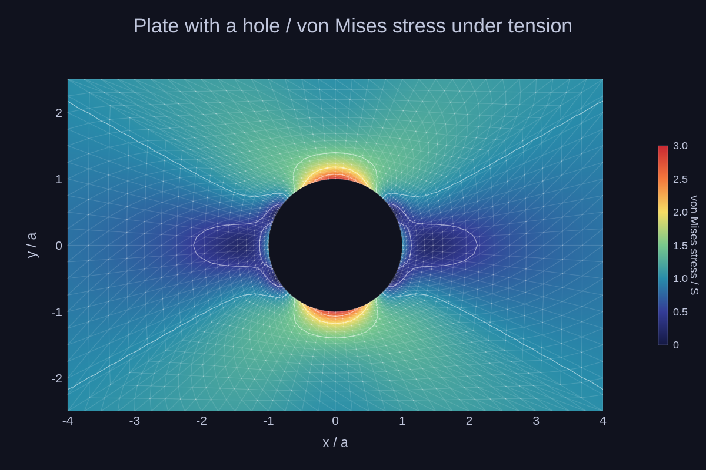
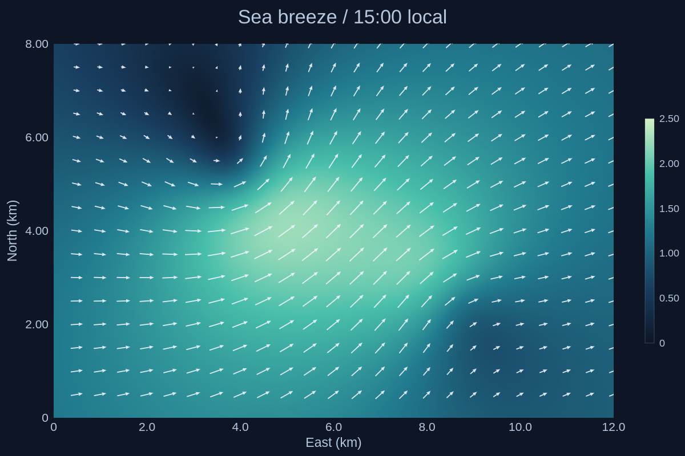
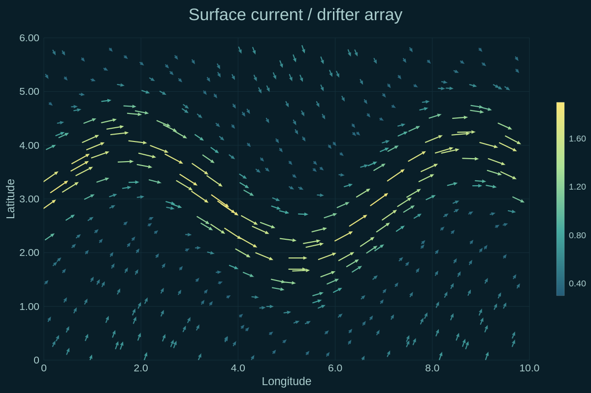
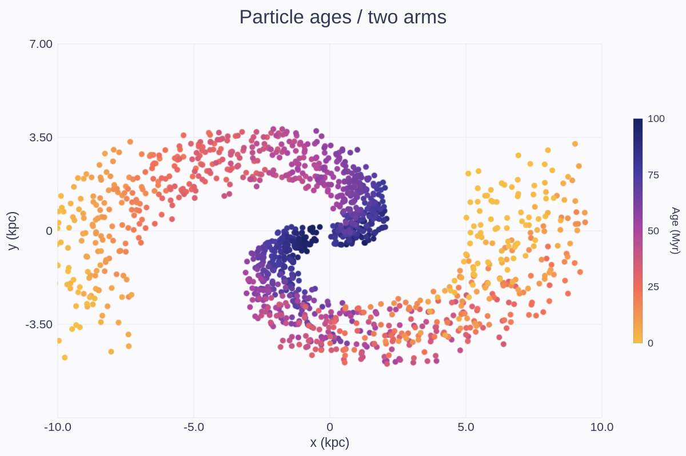
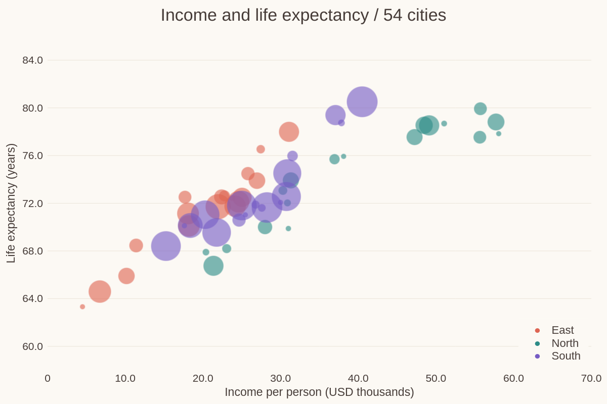

# Fields and maps

[← Gallery](../../../README.md#gallery) · [Lines, areas and stems](lines.md) · [Bars and distributions](distributions.md) · [Ranges and timelines](ranges.md) · **Fields and maps** · [3D](3d.md) · [Polar and radial](polar.md) · [Science diagrams](science.md) · [Layouts and annotations](layouts.md) · [Styles and visual concepts](styles.md)

Click an image to open the example code that draws it. All data is synthetic;
the images are native renderer output.

## Heatmap with contours

An interpolated matrix fill, labelled isolines with line gaps, a colourbar.

**Code:** [heatmap_contours.rs](../examples/heatmap_contours.rs), `contours`

**Run:** `cargo run --locked -p figgy-renderer --example heatmap_contours -- target/heatmap-contours`

## Hexbin

100,000 taxi pickups the host bins into counts on a hexagonal lattice (`GridLayout::Hexagonal`), on a log colourbar; empty cells are NaN.

**Code:** [heatmap_contours.rs](../examples/heatmap_contours.rs), `hexbin`

**Run:** `cargo run --locked -p figgy-renderer --example heatmap_contours -- target/heatmap-contours`

## Colour image

A planetary nebula as one `RgbImage`: three host-composited channel grids on one lattice of square pixels, interpolated, with field stars.

**Code:** [heatmap_contours.rs](../examples/heatmap_contours.rs), `imshow`

**Run:** `cargo run --locked -p figgy-renderer --example heatmap_contours -- target/heatmap-contours`

## Triangle mesh

Von Mises stress around a hole in a plate under tension (Kirsch's solution) on the host's graded mesh: interpolated fill, contour lines and the mesh edges as a faint line series.

**Code:** [trimesh.rs](../examples/trimesh.rs), `plate`

**Run:** `cargo run --locked -p figgy-renderer --example trimesh -- target/trimesh`

## Wind field

Grid vectors from two matrices over a speed heatmap.

**Code:** [vector_field.rs](../examples/vector_field.rs), `wind`

**Run:** `cargo run --locked -p figgy-renderer --example vector_field -- target/vector-field`

## Surface currents

Point vectors coloured by a speed column, scaled with `fit_scale`.

**Code:** [vector_field.rs](../examples/vector_field.rs), `currents`

**Run:** `cargo run --locked -p figgy-renderer --example vector_field -- target/vector-field`

## Colour-mapped points

`point_color_map`: points coloured by an age column through the colourbar.

**Code:** [value_maps.rs](../examples/value_maps.rs), `colormap_scatter`

**Run:** `cargo run --locked -p figgy-renderer --example value_maps -- target/value-maps`

## Bubble chart

`point_size_map`: marker area follows a population column.

**Code:** [value_maps.rs](../examples/value_maps.rs), `bubbles`

**Run:** `cargo run --locked -p figgy-renderer --example value_maps -- target/value-maps`
