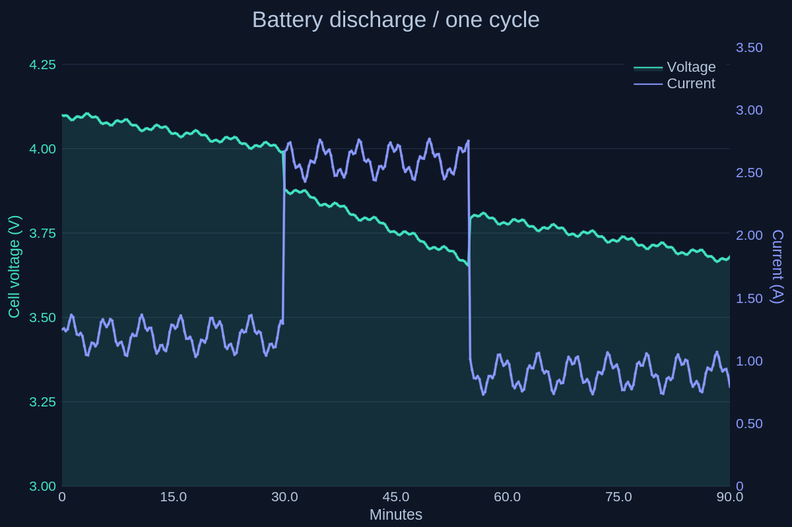
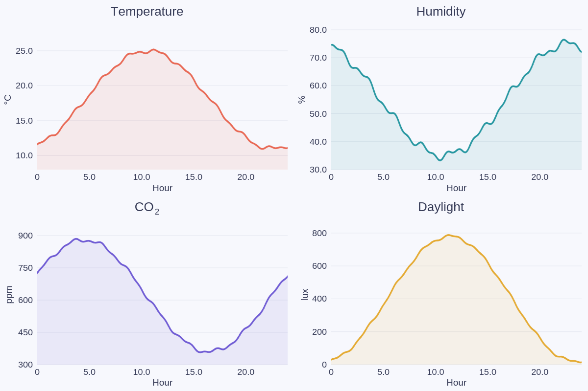
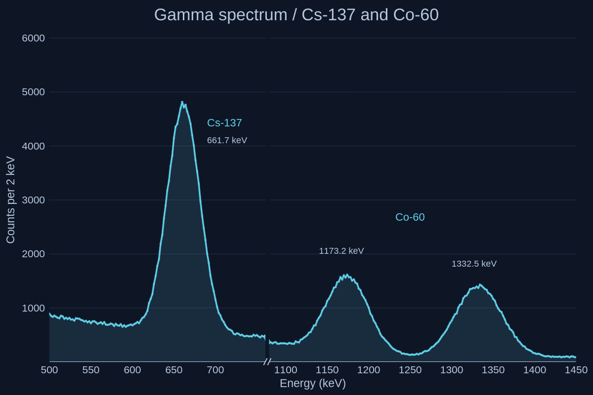
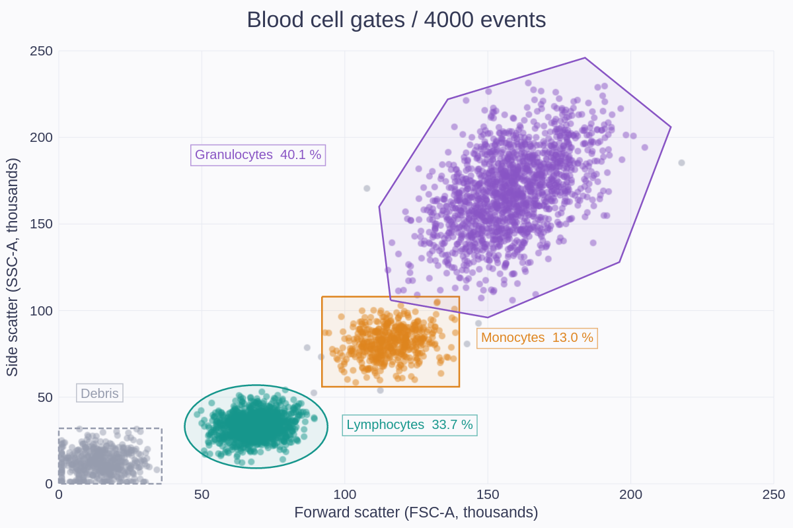

# Layouts and annotations

[← Gallery](../../../README.md#gallery) · [Lines, areas and stems](lines.md) · [Bars and distributions](distributions.md) · [Ranges and timelines](ranges.md) · [Fields and maps](fields.md) · [3D](3d.md) · [Polar and radial](polar.md) · [Science diagrams](science.md) · **Layouts and annotations** · [Styles and visual concepts](styles.md)

Click an image to open the example code that draws it. All data is synthetic;
the images are native renderer output.
Each entry names the built-in theme its example applies
([Themes](../USAGE.md#themes)); some examples edit a copy first, such as the
palette order or a fill opacity.

## Twin axes

An overlay layer with its own right Y axis, exported as a document.

**Code:** [overlay_axes.rs](../examples/overlay_axes.rs), `twin_axes`

**Theme:** `line` theme `midnight`

**Run:** `cargo run --locked -p figgy-renderer --example overlay_axes -- target/overlay-axes`

## Small multiples

A 2 × 2 grid: the parent and three subplots linked to its X axis, each with its own Y range.

**Code:** [subplots.rs](../examples/subplots.rs), `small_multiples`

**Theme:** `line` theme `cool-slate`

**Run:** `cargo run --locked -p figgy-renderer --example subplots -- target/subplots`

## Broken axis

A gamma-ray spectrum of Cs-137 and Co-60 with the energy axis cut between 760 and 1080 keV, so both peak groups keep a readable scale.

**Code:** [broken_axes.rs](../examples/broken_axes.rs), `gamma_spectrum`

**Theme:** `line` theme `midnight`

**Run:** `cargo run --locked -p figgy-renderer --example broken_axes -- target/broken-axes`

## Shape annotations

4000 flow cytometry events with shape annotations as gates: an ellipse, a rectangle, a polygon and a dashed outline, labelled in text boxes.

**Code:** [overlay_axes.rs](../examples/overlay_axes.rs), `shapes`

**Theme:** `scatter` theme `cool-slate`

**Run:** `cargo run --locked -p figgy-renderer --example overlay_axes -- target/overlay-axes`
