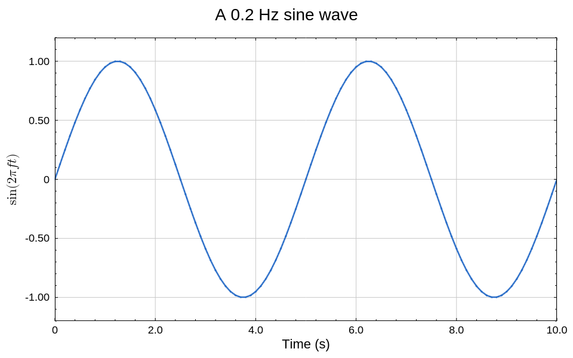
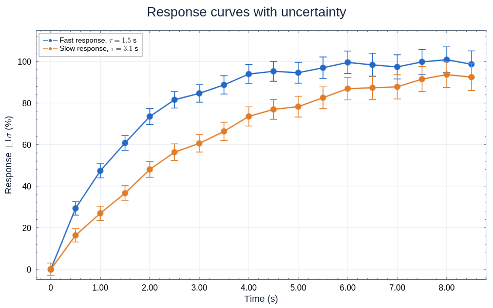
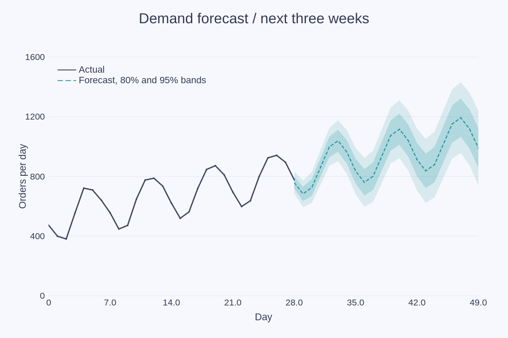
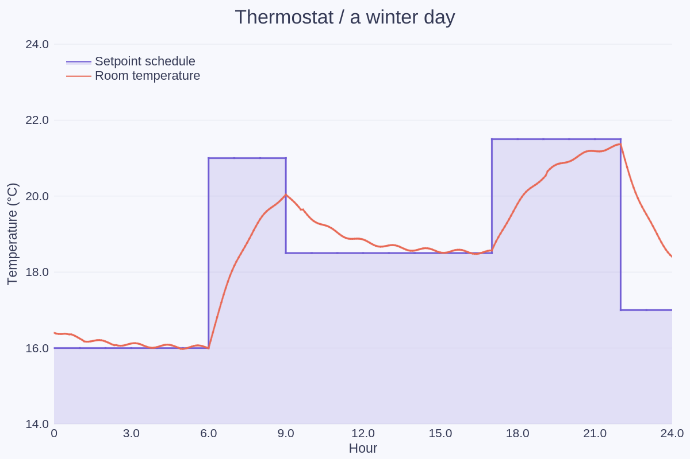
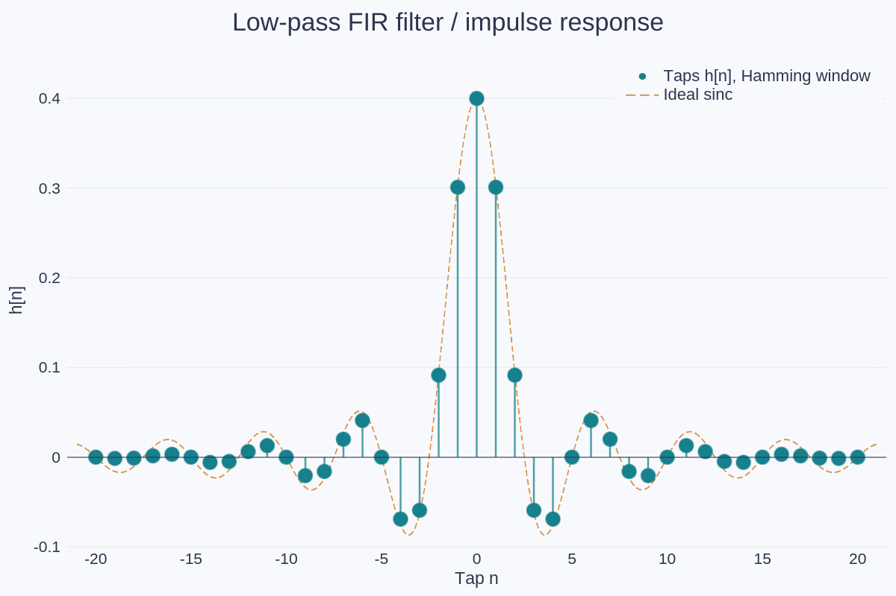
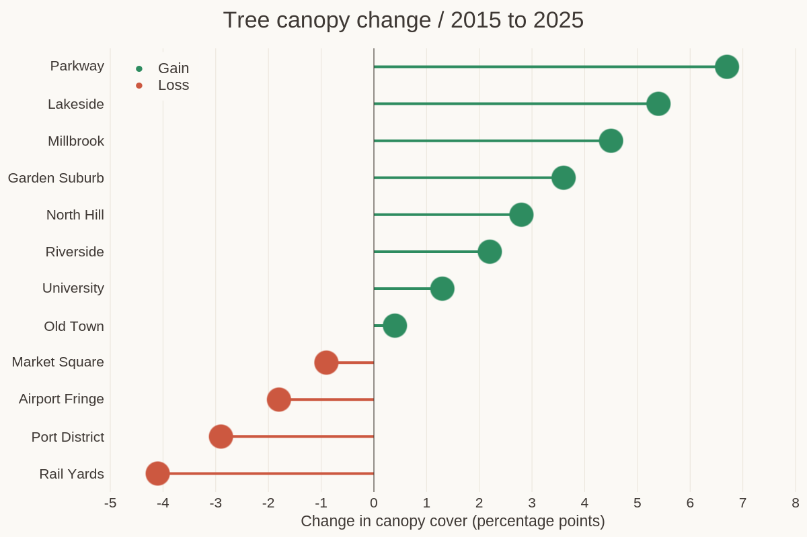
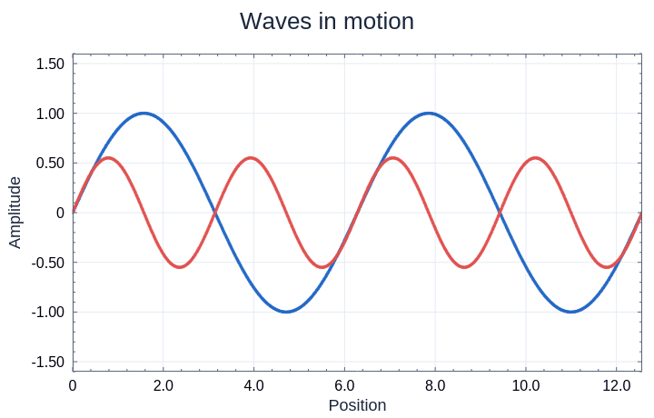
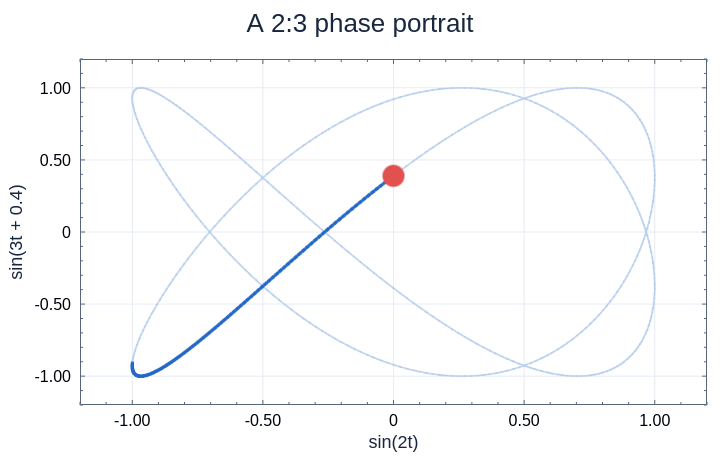

# Lines, areas and stems

[← Gallery](../../../README.md#gallery) · **Lines, areas and stems** · [Bars and distributions](distributions.md) · [Ranges and timelines](ranges.md) · [Fields and maps](fields.md) · [3D](3d.md) · [Polar and radial](polar.md) · [Science diagrams](science.md) · [Layouts and annotations](layouts.md) · [Styles and visual concepts](styles.md)

Click an image to open the example code that draws it. All data is synthetic;
the images are native renderer output.
Each entry names the built-in theme its example applies
([Themes](../USAGE.md#themes)); some examples edit a copy first, such as the
palette order or a fill opacity.

## Sine curve

The complete minimal setup: two columns, one line series, one PNG.

**Code:** [line.rs](../examples/line.rs), `main`

**Theme:** `line` theme `default`, with a blue, heavier line

**Run:** `cargo run --locked -p figgy-renderer --example line -- target/line.png`

## Error bars

Lines, markers and symmetric error bars from X, Y and error columns.

**Code:** [error_bars.rs](../examples/error_bars.rs), `render`

**Theme:** `error-bars` theme `gallery`

**Run:** `cargo run --locked -p figgy-renderer --example error_bars -- target/error-bars`

## Forecast bands

`LineFill::ToSeries` bands; NaN samples break each line.

**Code:** [area_step.rs](../examples/area_step.rs), `forecast`

**Theme:** `line` theme `cool-slate`

**Run:** `cargo run --locked -p figgy-renderer --example area_step -- target/area-step`

## Step schedule

A `StepPost` line filled to a baseline.

**Code:** [area_step.rs](../examples/area_step.rs), `thermostat`

**Theme:** `line` theme `cool-slate`

**Run:** `cargo run --locked -p figgy-renderer --example area_step -- target/area-step`

## Stem plot

The 41 taps of a windowed-sinc low-pass filter as stems from zero, over the ideal sinc they approximate.

**Code:** [stem.rs](../examples/stem.rs), `impulse_response`

**Theme:** `stem` theme `cool-slate`

**Run:** `cargo run --locked -p figgy-renderer --example stem -- target/stem`

## Lollipop chart

A ranked lollipop chart of tree canopy change in twelve districts: horizontal stems from zero on a categorical axis.

**Code:** [stem.rs](../examples/stem.rs), `lollipop`

**Theme:** `stem` theme `warm-paper`

**Run:** `cargo run --locked -p figgy-renderer --example stem -- target/stem`

## Travelling waves

Columns replaced every frame; writes `wave/NNN.png` frames, encoded as described in [the gallery notes](../GALLERY.md#encode-the-gifs).

**Code:** [animated_lines.rs](../examples/animated_lines.rs), `render`

**Theme:** `line` theme `gallery`

**Run:** `cargo run --locked -p figgy-renderer --example animated_lines -- target/animation 48`

## Animated orbit

A moving trail and a highlighted point; writes `orbit/NNN.png` frames.

**Code:** [animated_lines.rs](../examples/animated_lines.rs), `render`

**Theme:** `line` theme `gallery`

**Run:** `cargo run --locked -p figgy-renderer --example animated_lines -- target/animation 48`
