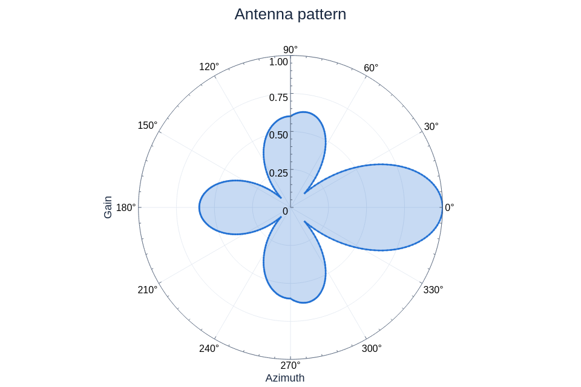
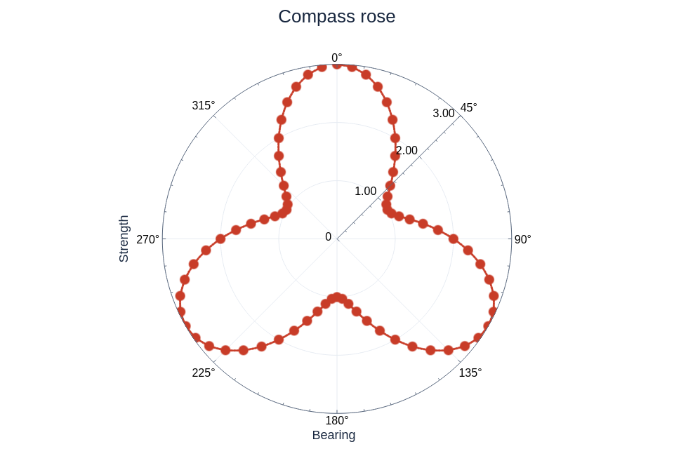
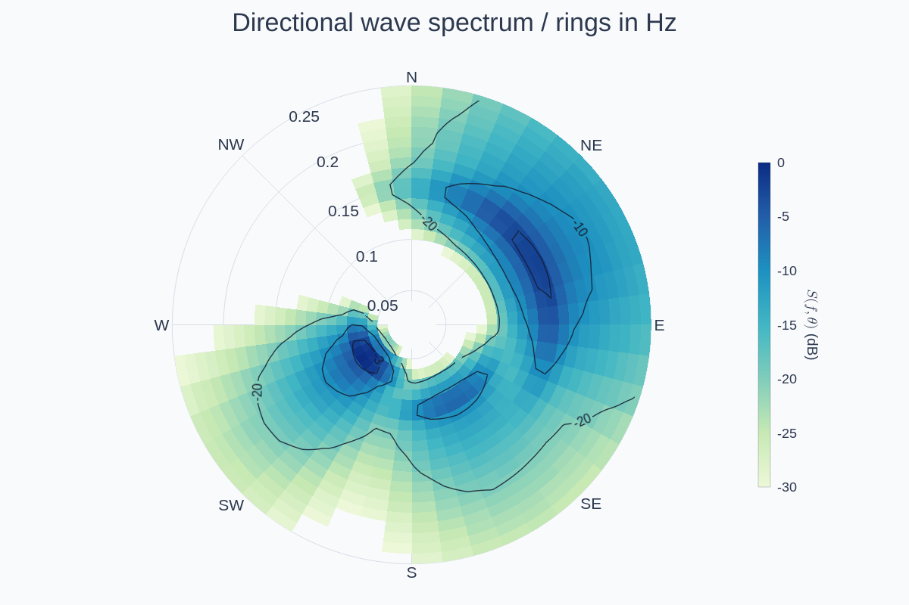
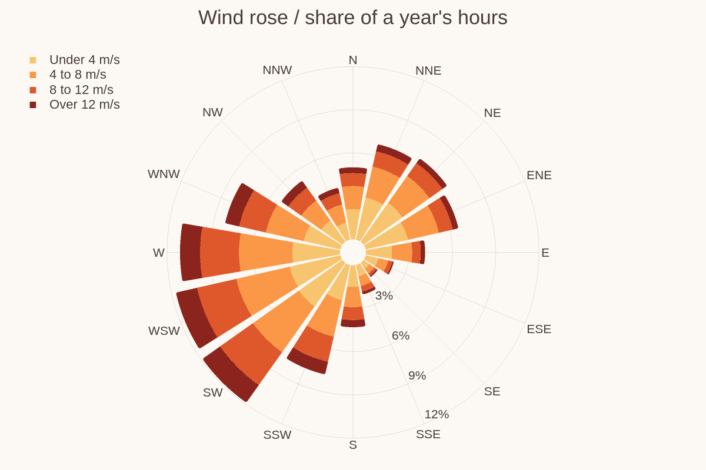
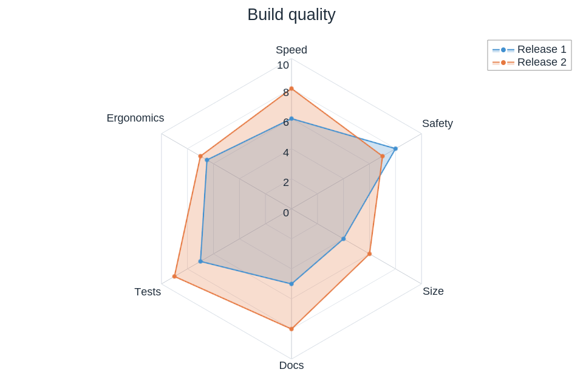
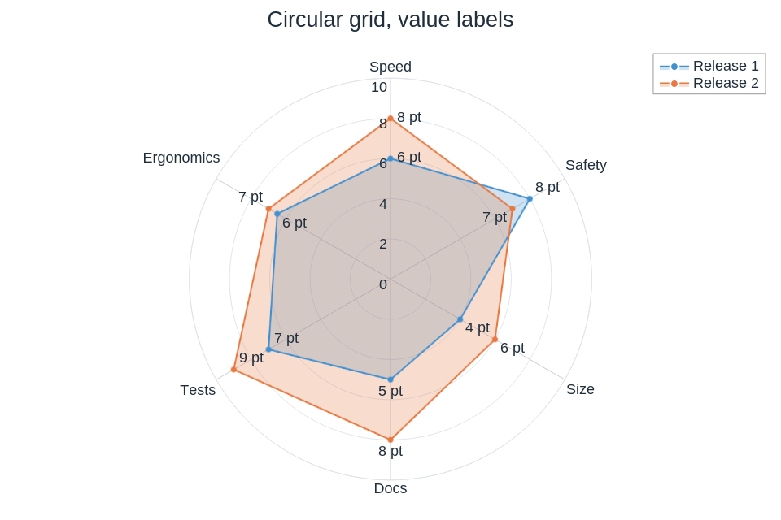
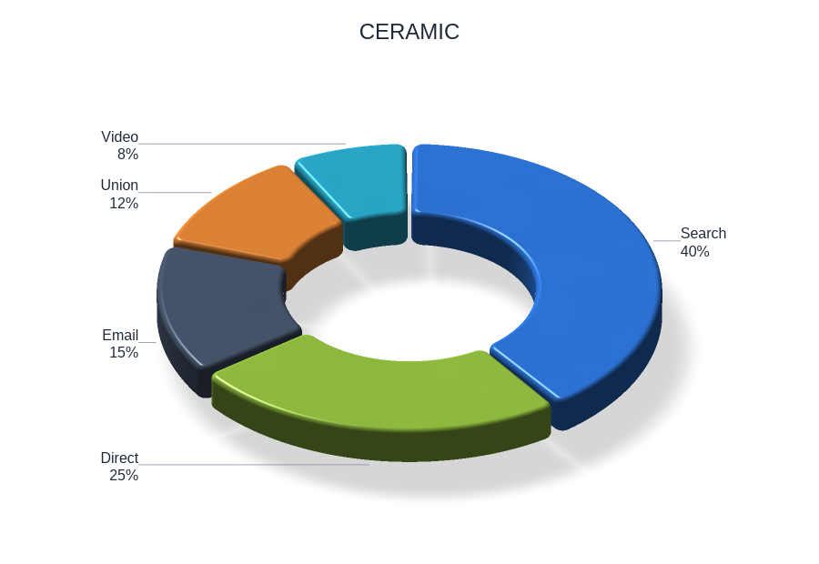
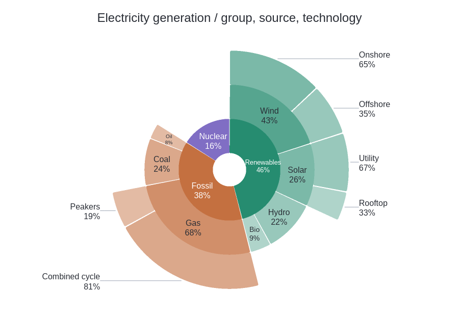

# Polar and radial

[← Gallery](../../../README.md#gallery) · [Lines, areas and stems](lines.md) · [Bars and distributions](distributions.md) · [Ranges and timelines](ranges.md) · [Fields and maps](fields.md) · [3D](3d.md) · **Polar and radial** · [Science diagrams](science.md) · [Layouts and annotations](layouts.md) · [Styles and visual concepts](styles.md)

Click an image to open the example code that draws it. All data is synthetic;
the images are native renderer output.
Each entry names the theme its example applies ([Themes](../USAGE.md#themes)):
a theme family, or a custom theme the example builds in its support code
(`examples/support/looks.rs`); some examples edit a copy first, such as the
palette order or a fill opacity.

## Polar plot

A line filled to the centre in polar coordinates, degree labels.

**Code:** [polar_plot.rs](../examples/polar_plot.rs), case `01-antenna-pattern`

**Theme:** the `gallery` family

**Run:** `cargo run --locked -p figgy-renderer --example polar_plot -- target/polar-plot`

## Compass rose

Clockwise from the top, arc segments, radius labels on the 45° ray.

**Code:** [polar_plot.rs](../examples/polar_plot.rs), case `02-compass-rose`

**Theme:** the `gallery` family

**Run:** `cargo run --locked -p figgy-renderer --example polar_plot -- target/polar-plot`

## Polar heatmap

A directional wave spectrum as annular cells: direction on a compass axis, frequency outward, energy in dB, with labelled polar contours.

**Code:** [polar_plot.rs](../examples/polar_plot.rs), `wave_spectrum`

**Theme:** the `cool-slate` family

**Run:** `cargo run --locked -p figgy-renderer --example polar_plot -- target/polar-plot`

## Wind rose

A wind rose: a year's hours from 16 directions as category bars stacked outward in four speed bands.

**Code:** [polar_plot.rs](../examples/polar_plot.rs), `wind_rose`

**Theme:** the `warm-paper` family

**Run:** `cargo run --locked -p figgy-renderer --example polar_plot -- target/polar-plot`

## Radar chart

Two series over six categories on a polygon grid.

**Code:** [radar_gallery.rs](../examples/radar_gallery.rs), case `01-spider-web`

**Theme:** the `gallery` family

**Run:** `cargo run --locked -p figgy-renderer --example radar_gallery -- target/radar-gallery`

## Radar with value labels

A circular grid with a value label at every vertex.

**Code:** [radar_gallery.rs](../examples/radar_gallery.rs), case `02-circle-values`

**Theme:** the `gallery` family

**Run:** `cargo run --locked -p figgy-renderer --example radar_gallery -- target/radar-gallery`

## Donut

Named values, rounded edges, an oblique view.

**Code:** [radial_gallery.rs](../examples/radial_gallery.rs), case `ceramic`

**Theme:** the `gallery` family

**Run:** `cargo run --locked -p figgy-renderer --example radial_gallery -- target/radial-gallery`

## Sunburst

A sunburst of electricity generation: groups at the centre, sources on the middle ring and technologies outside, each share relative to its parent.

**Code:** [radial_gallery.rs](../examples/radial_gallery.rs), `sunburst`

**Theme:** a custom radial theme, `looks::sunburst()` in the example support

**Run:** `cargo run --locked -p figgy-renderer --example radial_gallery -- target/radial-gallery`
