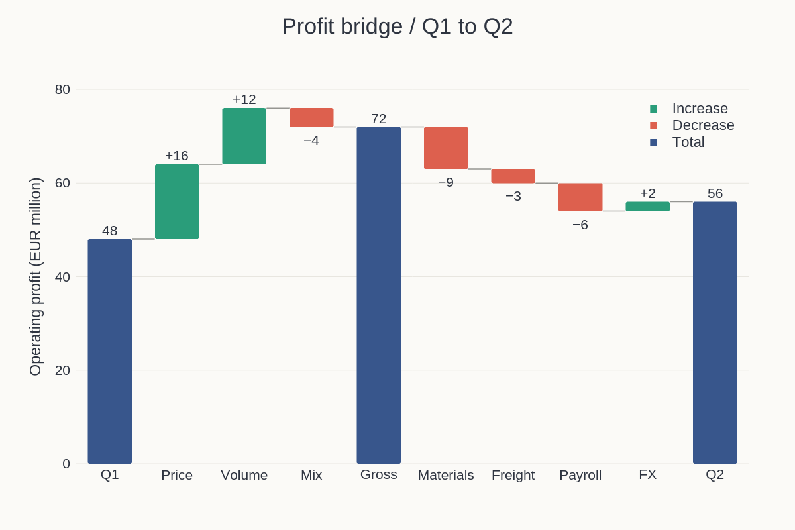
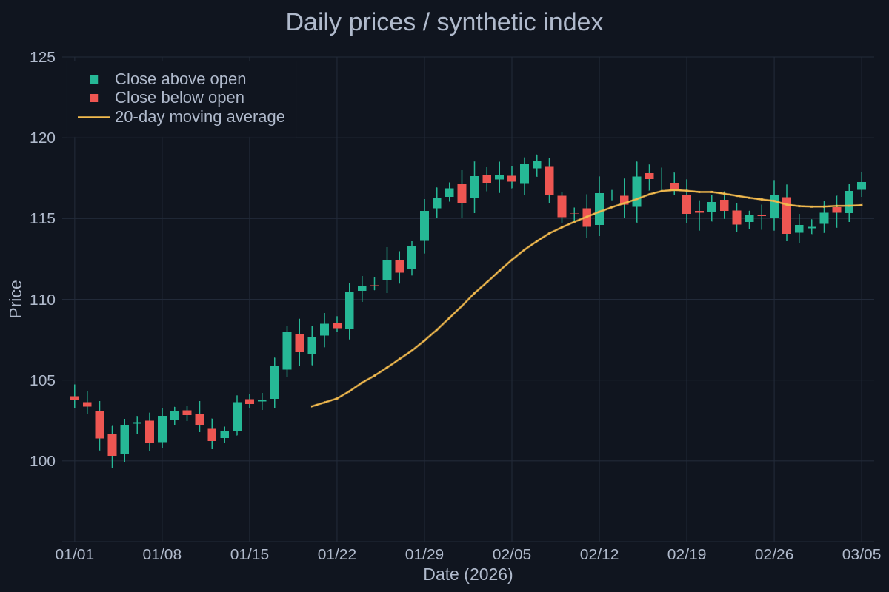
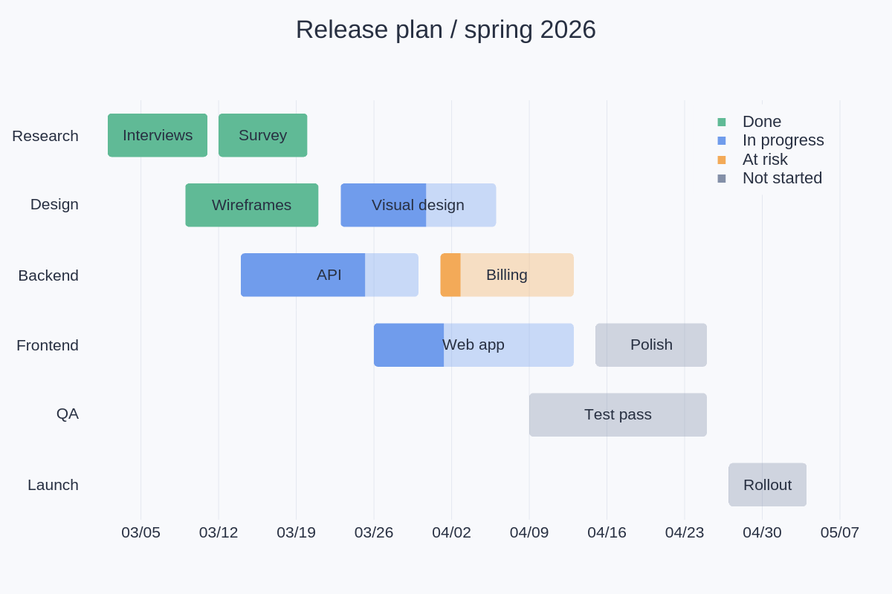

# Ranges and timelines

[← Gallery](../../../README.md#gallery) · [Lines, areas and stems](lines.md) · [Bars and distributions](distributions.md) · **Ranges and timelines** · [Fields and maps](fields.md) · [3D](3d.md) · [Polar and radial](polar.md) · [Science diagrams](science.md) · [Layouts and annotations](layouts.md) · [Styles and visual concepts](styles.md)

Click an image to open the example code that draws it. All data is synthetic;
the images are native renderer output.
Each entry names the built-in theme its example applies
([Themes](../USAGE.md#themes)); some examples edit a copy first, such as the
palette order or a fill opacity.

## Waterfall

A profit bridge: the host's running totals as start and end columns, increases and decreases coloured by direction, subtotal and totals flagged, connectors between the steps.

**Code:** [range_bars.rs](../examples/range_bars.rs), `waterfall`

**Theme:** `range-bars` theme `warm-neutral`

**Run:** `cargo run --locked -p figgy-renderer --example range_bars -- target/range-bars`

## Candlesticks

64 days of synthetic prices on a date axis: open–close bodies, low–high wicks and the host's 20-day moving average.

**Code:** [range_bars.rs](../examples/range_bars.rs), `candlestick`

**Theme:** `range-bars` theme `midnight`

**Run:** `cargo run --locked -p figgy-renderer --example range_bars -- target/range-bars`

## Gantt chart

A release plan on six rows over a date axis: a state column colours each task and a progress column shades its finished part.

**Code:** [range_bars.rs](../examples/range_bars.rs), `gantt`

**Theme:** `range-bars` theme `cool-slate`

**Run:** `cargo run --locked -p figgy-renderer --example range_bars -- target/range-bars`
