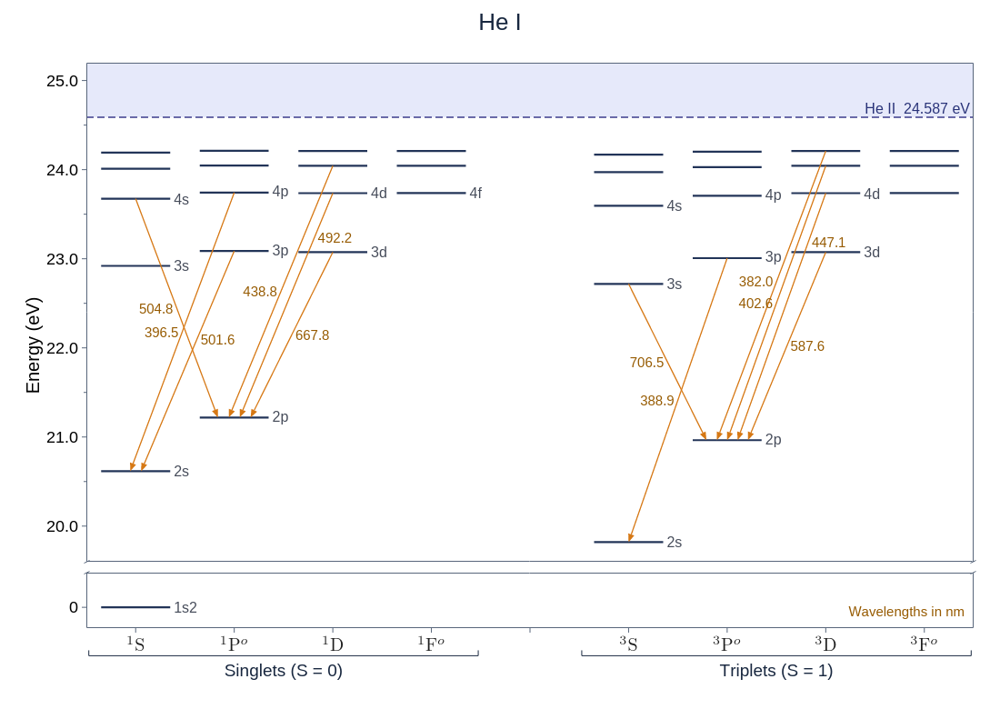
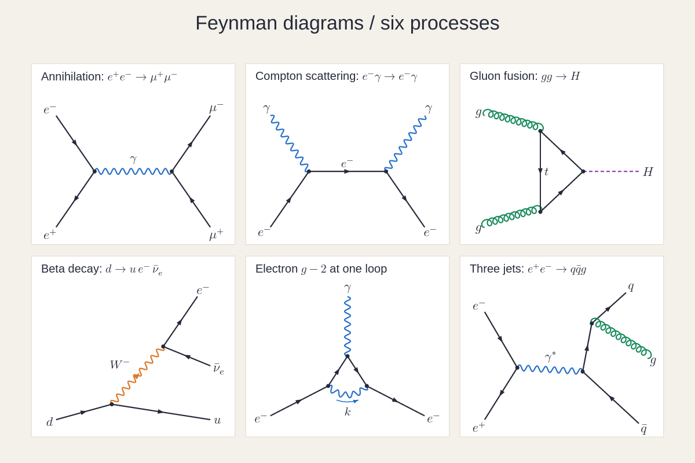
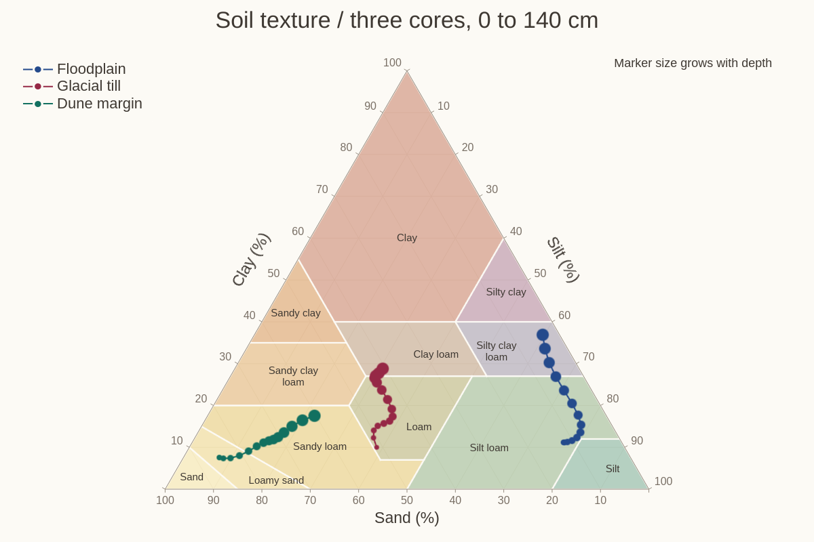
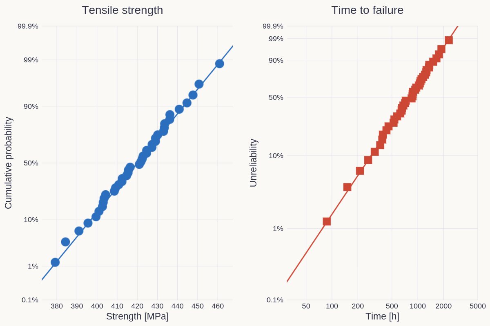
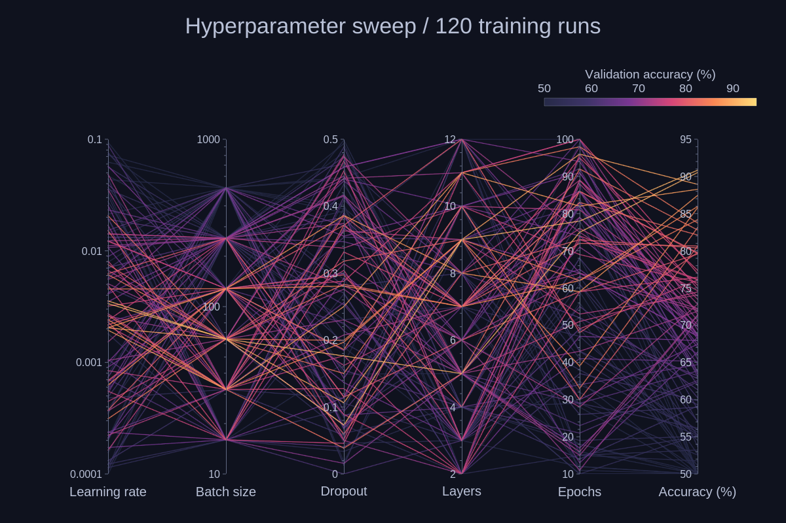

# Science diagrams

[← Gallery](../../../README.md#gallery) · [Lines, areas and stems](lines.md) · [Bars and distributions](distributions.md) · [Ranges and timelines](ranges.md) · [Fields and maps](fields.md) · [3D](3d.md) · [Polar and radial](polar.md) · **Science diagrams** · [Layouts and annotations](layouts.md) · [Styles and visual concepts](styles.md)

Click an image to open the example code that draws it. All data is synthetic
except the energy-level diagram, which draws the bundled NIST ASD exports for
He I; the images are native renderer output.
Each entry names the built-in theme its example applies
([Themes](../USAGE.md#themes)); some examples edit a copy first, such as the
palette order.

## Energy levels

A Grotrian diagram of He I from NIST data: singlet and triplet term columns, transitions labelled with their wavelengths to one decimal, the unit once in a corner note, the ground state below a broken energy axis.

**Code:** [nist_grotrian_gallery.rs](../examples/nist_grotrian_gallery.rs), case `he-i` (`he-i-1x.png`); the diagram is `helium` in [support/grotrian_sets.rs](../examples/support/grotrian_sets.rs)

**Theme:** `energy-levels` theme `grotrian`

**Run:** `cargo run --locked -p figgy-renderer --example nist_grotrian_gallery -- target/nist-grotrian-gallery`

## Feynman diagrams

Six processes on cards: annihilation, Compton scattering, gluon fusion through a top loop, beta decay through a W, the electron's one-loop vertex and a three-jet event.

**Code:** [feynman.rs](../examples/feynman.rs), `render`

**Theme:** `feynman` theme `parchment`

**Run:** `cargo run --locked -p figgy-renderer --example feynman -- target/feynman`

## Ternary plot

The USDA soil texture triangle: twelve texture classes as filled region polygons named by text annotations, and three soil cores sampled every 10 cm as lines whose markers grow with depth (`point_size_map`).

**Code:** [ternary.rs](../examples/ternary.rs), `render`

**Theme:** `ternary` theme `warm-paper`

**Run:** `cargo run --locked -p figgy-renderer --example ternary -- target/ternary`

## Probability paper

Normal and Weibull probability axes (#209), the Weibull panel over a log time axis.

**Code:** [probability_paper.rs](../examples/probability_paper.rs), `probability_paper`

**Theme:** `probability` theme `warm-neutral`

**Run:** `cargo run --locked -p figgy-renderer --example probability_paper -- target/probability`

## Parallel coordinates

A 120-run hyperparameter sweep across six axes (two of them logarithmic), each run coloured by its validation accuracy through the colourbar, the best drawn last.

**Code:** [parallel.rs](../examples/parallel.rs), `render`

**Theme:** `parallel` theme `midnight`

**Run:** `cargo run --locked -p figgy-renderer --example parallel -- target/parallel`
