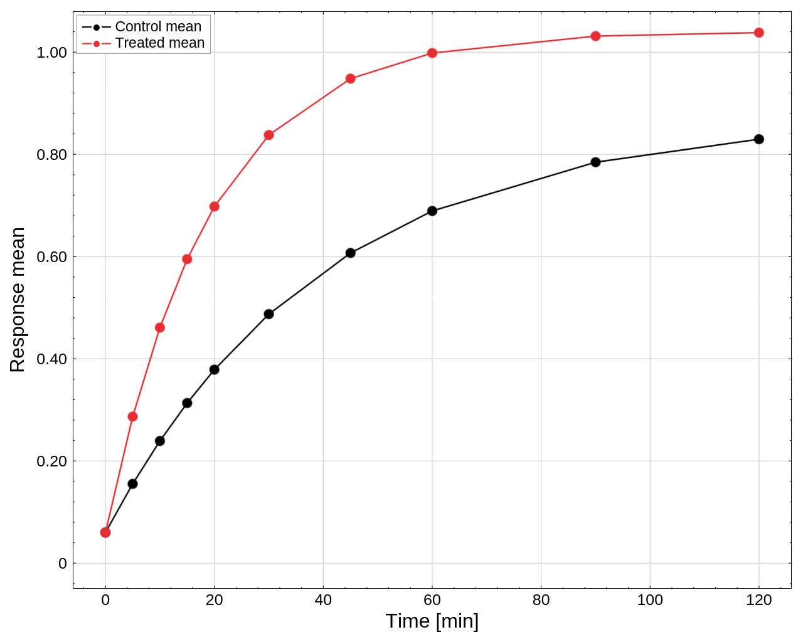
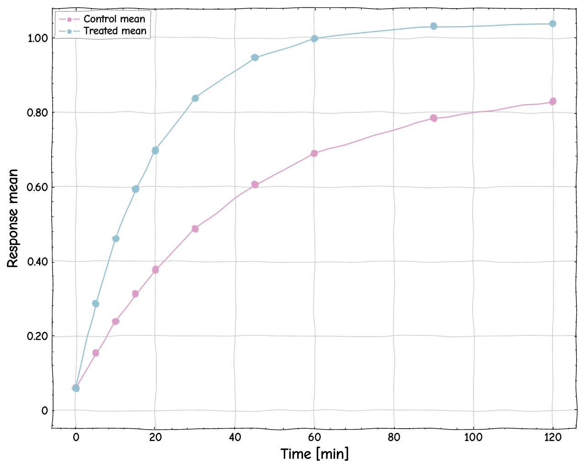
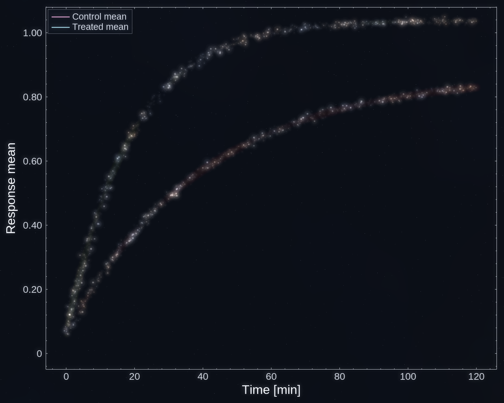
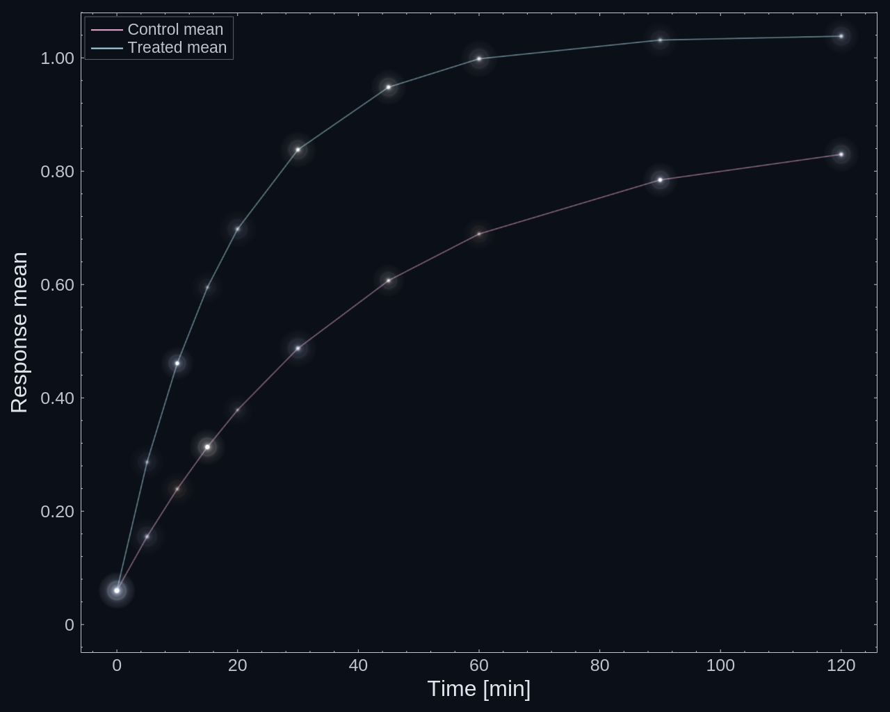
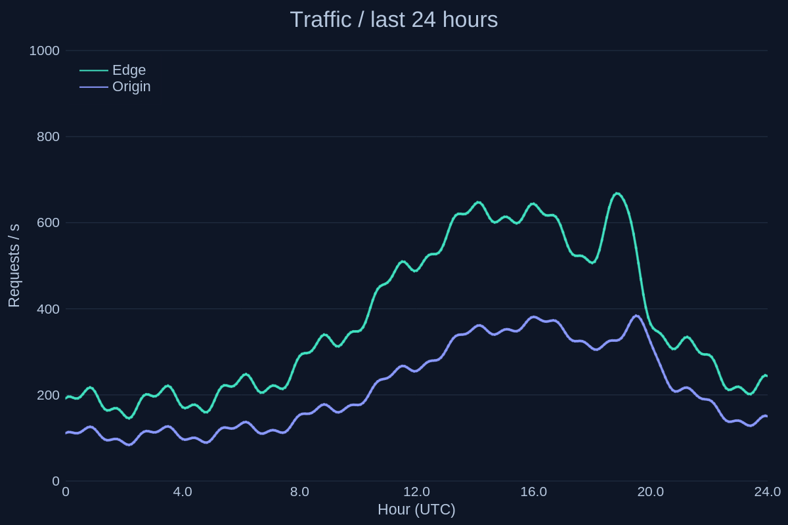
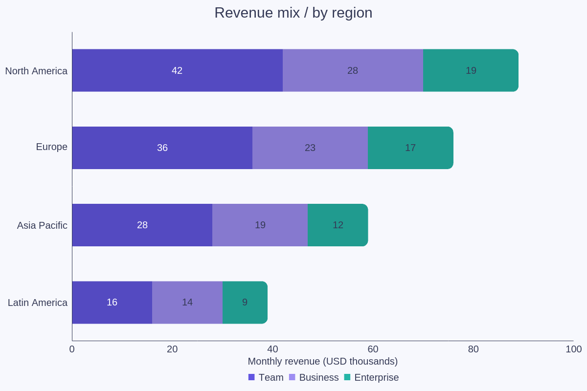
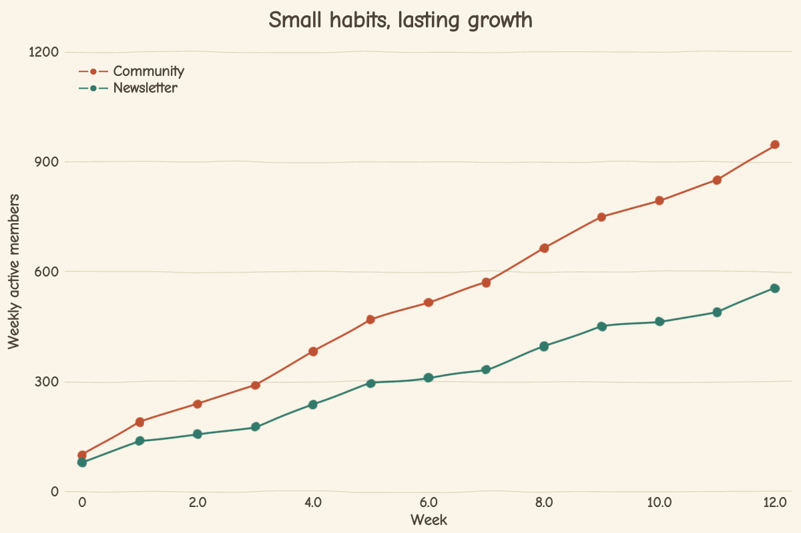
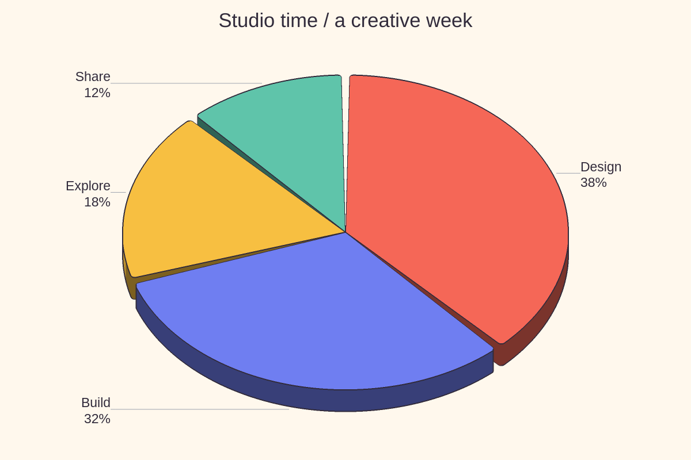
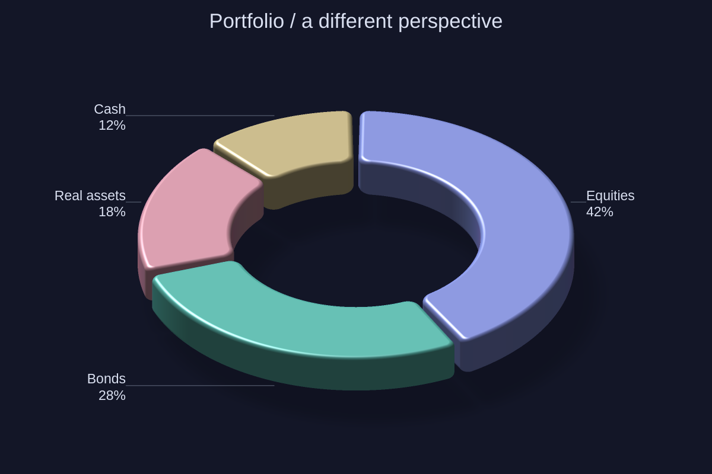
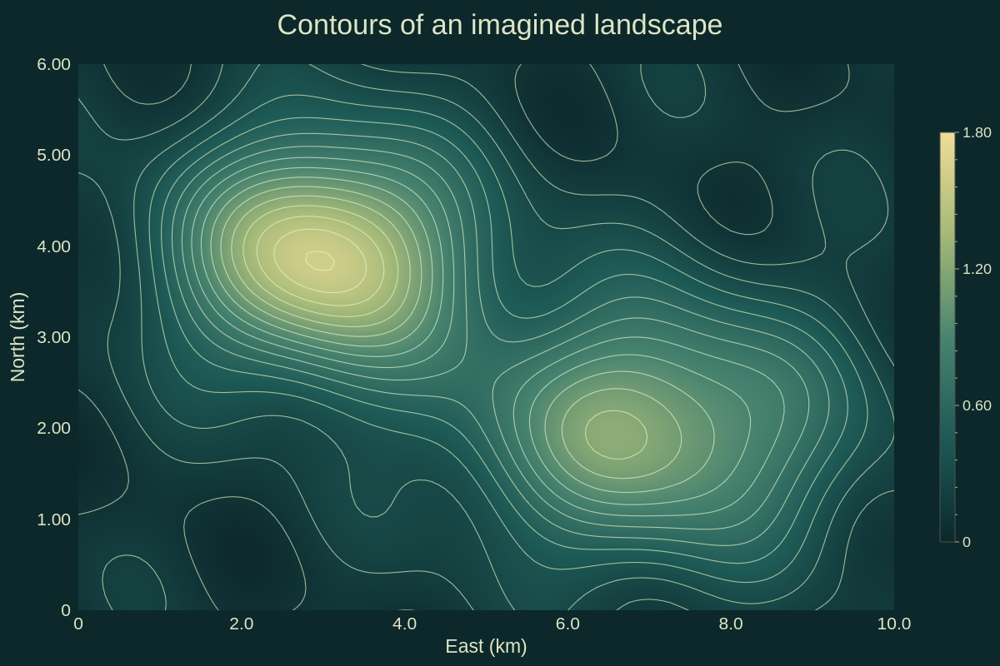

# Styles and visual concepts

[← Gallery](../../../README.md#gallery) · [Lines, areas and stems](lines.md) · [Bars and distributions](distributions.md) · [Ranges and timelines](ranges.md) · [Fields and maps](fields.md) · [3D](3d.md) · [Polar and radial](polar.md) · [Science diagrams](science.md) · [Layouts and annotations](layouts.md) · **Styles and visual concepts**

Click an image to open the example code that draws it. All data is synthetic;
the images are native renderer output.
Each entry names the theme its example applies ([Themes](../USAGE.md#themes)):
a theme family, or a custom theme the example builds in its support code
(`examples/support/looks.rs`); some examples edit a copy first, such as the
palette order or a fill opacity.

## Precise style

`DrawStyle::Precise`.

**Code:** [precise_sketch_preview.rs](../examples/precise_sketch_preview.rs), `main`

**Theme:** the documented look (`Theme::default()`), with larger text

**Run:** `cargo run --locked -p figgy-renderer --example precise_sketch_preview -- target/precise-sketch`

## Sketch style

`DrawStyle::Sketch` on the same data.

**Code:** [precise_sketch_preview.rs](../examples/precise_sketch_preview.rs), `main`

**Theme:** the documented look (`Theme::default()`), with larger text and `DrawStyle::Sketch`

**Run:** `cargo run --locked -p figgy-renderer --example precise_sketch_preview -- target/precise-sketch`

## Milkyway style

Milkyway on `Line` series: stars and nebula only.

**Code:** [milkyway_line_preview.rs](../examples/milkyway_line_preview.rs), `main`

**Theme:** a custom theme, `looks::milkyway()` in the example support

**Run:** `cargo run --locked -p figgy-renderer --example milkyway_line_preview -- target/milkyway-preview.png`

## Constellation style

Constellation on `ScatterLine` series: stars at the source samples.

**Code:** [constellation_preview.rs](../examples/constellation_preview.rs), `main`

**Theme:** a custom theme, `looks::constellation()` in the example support

**Run:** `cargo run --locked -p figgy-renderer --example constellation_preview -- target/constellation-preview.png`

## Dark dashboard

A dark service-monitoring card.

**Code:** [gallery_concepts.rs](../examples/gallery_concepts.rs), `observability`

**Theme:** the `midnight` family

**Run:** `cargo run --locked -p figgy-renderer --example gallery_concepts -- target/concepts`

## Revenue stacks

Rounded horizontal stacked bars with inside labels.

**Code:** [gallery_concepts.rs](../examples/gallery_concepts.rs), `revenue`

**Theme:** a custom theme, `looks::revenue()` in the example support

**Run:** `cargo run --locked -p figgy-renderer --example gallery_concepts -- target/concepts`

## Editorial sketch

A warm paper-coloured Sketch figure.

**Code:** [gallery_concepts.rs](../examples/gallery_concepts.rs), `editorial`

**Theme:** a custom theme, `looks::editorial()` in the example support

**Run:** `cargo run --locked -p figgy-renderer --example gallery_concepts -- target/concepts`

## Toon pie

A toon-shaded pie with outlines.

**Code:** [gallery_concepts.rs](../examples/gallery_concepts.rs), `radial_concepts`

**Theme:** the `warm-paper` family

**Run:** `cargo run --locked -p figgy-renderer --example gallery_concepts -- target/concepts`

## Pearl donut

A pearl donut from the same slice model.

**Code:** [gallery_concepts.rs](../examples/gallery_concepts.rs), `radial_concepts`

**Theme:** the `midnight` family

**Run:** `cargo run --locked -p figgy-renderer --example gallery_concepts -- target/concepts`

## Terrain

A custom colour ramp under fine isolines.

**Code:** [gallery_concepts.rs](../examples/gallery_concepts.rs), `terrain`

**Theme:** a custom theme, `looks::topographic()` in the example support

**Run:** `cargo run --locked -p figgy-renderer --example gallery_concepts -- target/concepts`
